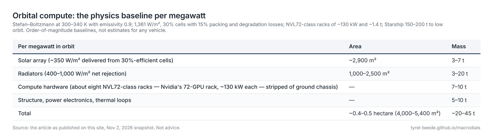
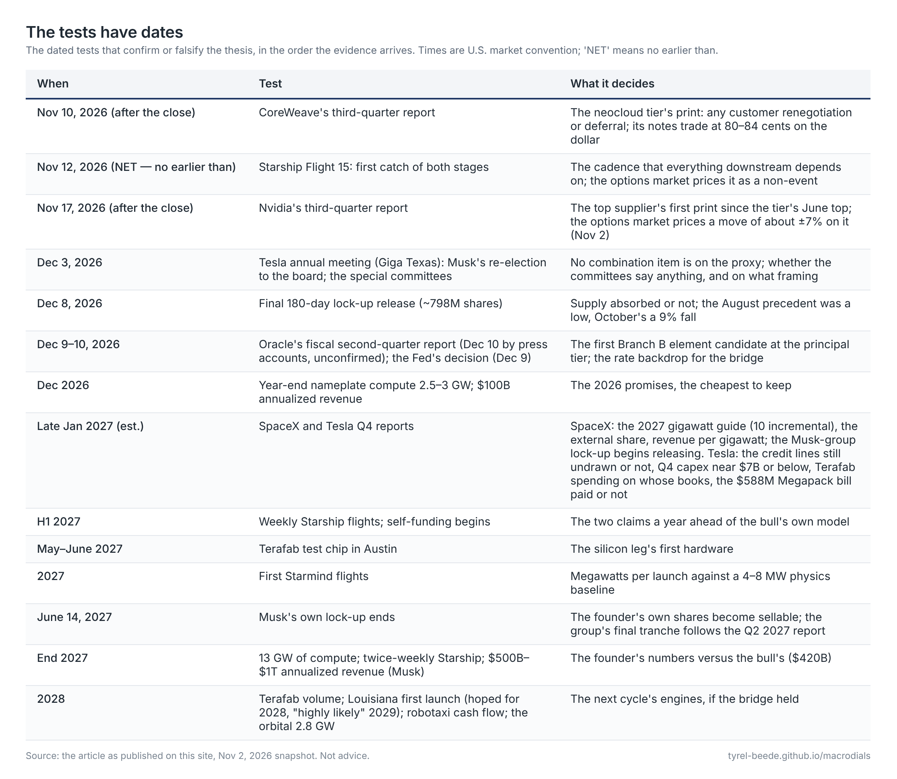

---
date:
  created: 2026-11-02
  updated: 2026-11-03
categories:
  - Articles
description: The physics, the money and the cycle behind a SpaceX–Tesla machine — a snapshot as of the Nov 2, 2026 close.
---

# Better Together Than Alone

*The physics, the money and the cycle behind a SpaceX–Tesla machine — and why the most ambitious vertical-integration bet since Standard Oil may need two companies to survive one trough.*

<!-- more -->

## How to read this

This is an account of a plausible future, not a forecast. Everything in it is as of Monday, Nov 2, 2026 — prices at that day's close, the dashboard's readings and branch weights from that evening's run, the corporate record through that day; earlier figures carry their own dates. It is assembled from three kinds of material: the companies' own words and filings (SpaceX's official third-quarter webcast of Oct 20, 2026, and Tesla's third-quarter report and 10-Q of Oct 21), the prices the market itself is quoting (the stocks, their options, the credit markets, the positioning data), and the readings of a macro dashboard that has spent the autumn trying to date where the artificial-intelligence capital-spending cycle stands. Where a number comes from a bull's spreadsheet or from management's ambition rather than from a filing, the text says so.

The dashboard's frame is simple enough to carry in your head. It sorts the near future into three branches: **Branch A**, a healthy expansion in which the spending continues and credit stays calm; **Branch B**, a capital-spending bust that begins at the edges of the AI supply chain and works inward; and **Branch C**, a debt crunch in the government bond market that would hit everything at once. As of Nov 2 it weights the six weeks to the Dec 9 Fed meeting at roughly 79% A, 19% B and 2% C (rounded), the quarter to late January at 66/31/3 with wide error bars, and declines to put a number on 2027 at all. The reason it declines is the reason this document exists: three economic cycles — business, capital spending and debt — are at phases that have no joint precedent, and the SpaceX–Tesla thesis is, at bottom, a bet on how those cycles land.

The argument proceeds in layers. First the setting: what the market was doing in the last week of October. Then the mechanism: how a capital-spending boom moves its bottleneck from one input to the next, and why the companies that own the next bottleneck earn the next profit. Then SpaceX as it stands, the spreadsheet a prominent investor has posted for it, and the price the market is paying. Then the hard parts — the physics of putting computers in orbit, the economics of being the low-cost producer of a wasting asset, the funding of a build that burns more cash than any private company has ever burned — and finally why Tesla and SpaceX may need each other, what a second cash engine would look like, and the dated tests that will decide all of it. Nothing here is a recommendation. It is a map of the terrain, drawn so that the reader can watch the future arrive and mark it against the map.

## The week the market stopped paying the spenders

On the evening of Oct 28, Alphabet told investors that its capital budget for the year was unchanged at $195 billion to $205 billion and that 2027's would "increase significantly." The next day its stock fell 12.6%, a drastic one-day repricing for a company of its size. Microsoft had just trimmed its calendar-2026 spending by $5 billion — not from restraint but because third-party data-center capacity it expected was delayed, with "customer demand continues to exceed available supply" in the same breath — and sold $25 billion of bonds into $115 billion of orders. Amazon guided 2026 capital spending to about $220 billion, said 2027 would be "meaningfully more," reported twelve-month free cash flow of −$42 billion and long-term debt of $173 billion against $66 billion a year earlier, and disclosed that it had now put $50 billion into OpenAI while booking $100 billion of OpenAI's commitments into its own cloud backlog. Meta, in the same week, closed the sale of $25 billion of stock and $12.5 billion of convertible preferred. Of the five AI principals that reported in October — Microsoft, Alphabet, Amazon, Meta and SpaceX — none cut its 2027 plans; Oracle reports in December.

The market's answer was the pattern these pages keep returning to. The equal-weight version of the S&P 500 — in which Walmart counts for exactly as much as Nvidia — finished October up 4.5%, while the familiar size-weighted index fell 1.1%. Energy, utilities, materials, health care and consumer staples led. The share of index members trading above their own 200-day average price went from 40.8% on Oct 1 to 63.7% four weeks later, the fastest repair in the dashboard's one-year file, with 31 new 52-week highs against two new lows on Oct 29. The semiconductor index fell 7% in a single session on Oct 30; Nvidia fell 4%, SpaceX 6%. Volume told the same story: in the Nasdaq-100 fund, down-day volume ran two and a half times up-day volume; in the equal-weight fund, the ratio ran the other way.

That is not a market fleeing. It is a market discriminating — rotating out of the companies that build and buy the AI machines and into nearly everything else, while corporate credit stays calm at the top of the ladder and restless below it (investment-grade spreads 94 basis points on Oct 30, back in the dashboard's "watch" zone after a one-day dip to 89, and every high-yield tier wider in the same session for the first time in the dashboard's file without the lowest tier leading, each of the three middle tiers one print from a confirmed "stress" reading on the dashboard's percentile bands), jobless claims sit near their lows at 194,000, and the Federal Reserve, which held in October with two dissents in favor of a hike, is priced at about three-in-four to raise rates on Dec 9. The dashboard called the configuration "A on state, B on stage" through October: the economy and credit describe a healthy expansion, while the stage indicators of the capital-spending cycle — peak margins at the scarcity point, negative free cash flow at the spenders, financing migrating from cash flow to debt, leases and stock — describe a boom in its late innings, five of its seven late-cycle markers now lit. On Nov 2 the state side stopped being settled: the dashboard's state label, which it now computes from the spread of its own simulations rather than asserting, flipped from A to "transition" (the mechanism is in the dashboard section below). The two readings are not in conflict. They are the same market seen at two time scales, and the companies in this story are the ones living at both.

One more fact from the ten-year price files, because it sets the clock. The supply side of the AI chain topped in June. The semiconductor index peaked on June 22 and Micron on June 25; SK hynix ran 50% in two weeks into June 22 and has fallen 51% since; as of Oct 29, Samsung was 38% below its high, Lam Research 41%, Applied Materials 42%, Micron 23% and Nvidia 11%, and Oct 30's selloff took the semiconductor index to 22% below its June high, Micron to 27% and Nvidia to 14%. The buyers' turn — Alphabet, Meta — came four months later. Suppliers first, then principals, is the order in which capital-spending cycles have always turned, and October 2026 is the month the sequence became visible.

## Terms used in this document

> **Capex** — capital expenditure: spending on long-lived assets; here, data centers, the chips inside them, rockets, satellites and factories.
>
> **Gigawatt (GW)** — a billion watts of electrical power; the unit the industry now uses to size AI data centers. A gigawatt of today's GPU racks is roughly 545,000 chips and costs tens of billions of dollars to fill.
>
> **GPU** — graphics processing unit, the Nvidia-style chip that trains and runs AI models; **GB300** and **Vera Rubin** are Nvidia's current and next generations.
>
> **Revenue per watt / per gigawatt** — what a data center earns each year for each unit of power it can supply to chips; the price of compute.
>
> **Spot versus take-or-pay** — spot means selling capacity at today's market price on short contracts; take-or-pay means a customer commits to pay for capacity for years whether it uses it or not.
>
> **EBITDA** — earnings before interest, taxes, depreciation and amortization: operating cash profit before the cost of the equipment is charged against it. **Free cash flow** is what is left after capex.
>
> **Credit spread** — the extra yield a company's bond pays over a Treasury, the market's price for the risk it won't pay; **investment grade** is the strong-balance-sheet tier, **high yield** the weaker one, **CCC** the riskiest. Measured in **basis points**, hundredths of a percent.
>
> **Lock-up** — the period after an IPO in which insiders and early investors may not sell; its expiry releases supply of shares.
>
> **Implied volatility** — the size of move an option's price assumes; **skew** is how much more buyers pay for protection against a fall than for a rise.
>
> **Neocloud** — a company that rents out GPU capacity it has built with borrowed money (CoreWeave, Nebius); the **principals** are the large companies that buy and build compute for their own products (Microsoft, Alphabet, Amazon, Meta, Oracle, SpaceX).
>
> **SI** — SpaceX's "Super Intelligence" segment: its AI models (Grok), its coding tool (Cursor), and its compute business, both the data centers on the ground and the planned ones in orbit (**Starmind**). **Terafab** is the chip factory SpaceX and Tesla plan to build together.
>
> **Branch A / B / C** — the dashboard's three futures: expansion, capex bust, debt crunch (defined above).
>
> **Tapered integration** — using and selling the same input at once: a company keeps part of a node's capacity for itself and sells the rest into the market, so it has both a captive customer and a market price.

## The cascade: how a boom moves its bottleneck

Every capital-spending boom is a relay race among shortages. When demand for a new kind of capacity arrives faster than the supply chain can grow, the scarcity rent — the extra profit that comes from being the thing everyone is waiting for — lands on whichever input is scarcest at that moment. The companies that own that input earn extraordinary margins. Those margins attract capital, the shortage is relieved, and the rent migrates to the next-scarcest input down the chain. The railways did it with iron, then land, then rolling stock, then money; the 1990s did it with routers, then fiber, then the electronics that light the fiber, then the customers who never came. The AI build is doing it in a sequence that can be read directly off company margins.

In 2023 and 2024 the bottleneck was the chips themselves, and Nvidia's gross margin rose into the mid-seventies. In 2025 and 2026 it moved to the memory that sits beside the chips — the high-bandwidth memory stacks that feed them — and the three companies that make it began earning margins no commodity manufacturer earns for long: Micron reported an 86.8% gross margin in its latest quarter; SK hynix an 80% operating margin in its Oct 28 results, against a 56.7% peak in the prior cycle, with fourteen customers signed to five-year contracts covering more than half of its 2027–28 output, deposits attached. The dashboard scores that as a stage marker, not a trend: peak margins at the scarcity point are how the top of a node looks from the inside. The first deceleration showed up at the NAND tier on Oct 30, when Kioxia guided a flat quarter, said next-quarter price growth would slow to low single digits from 20–25%, and noted that some enterprise orders had been pushed into the March quarter; its stock fell 16% at the next Tokyo session, on Nov 2.

The next node is already visible at the edges. Power. Not the average price of electricity, which is still around eight cents a kilowatt-hour, but the *marginal* price of a new gigawatt of firm power for a data center delivered on a schedule — which shows up in the places the average never does: the capacity auctions that clear the eastern grid (the clearing price rose roughly nine-fold in a single auction once data-center load entered the queue, and higher still in the next), the order books of the turbine makers (GE Vernova's delivery slots are largely sold through 2030 and its prices are rising; the figures are in the ground-power section below), nuclear restarts contracted at prices no one would have signed in 2022, and the gas plants Meta and xAI are building beside their sites because the grid will not deliver in time. The involuntary coordinators have begun to appear too — Texas's environmental regulator, the Texas grid operator, county moratoria — the institutions that, in every boom, start rationing what the market cannot.

There is a subtlety here that everything below depends on. Power is cheap as an *expense*: a gigawatt of GPUs costing $40 billion depreciates at roughly $10 million per megawatt-year, while the electricity to run a megawatt costs about $0.7 million a year — energy is perhaps 7% of what AI compute costs to own. But power is ruinously expensive as a *constraint*. Once the grid binds, the price of a megawatt stops being its $/kWh and becomes the profit on the compute that cannot be deployed without it: at the margins the bulls assume, about $30 million per megawatt-year, forty times the energy bill. A power plant costs a few percent of the compute it feeds; what it costs in time is four years, and four years is the entire scarcity window. Whoever holds the megawatts when the grid binds holds the compute margin. That is the logic of SpaceX's plan to add 20 gigawatts of power in 2027, and of its plan to put computers in orbit, and the two should be read together: both are purchases of lead time, not of kilowatt-hours.

Which brings the cascade to its strategic form. Each firm in this cycle is trying to move the bottleneck to the node it owns. Nvidia had it at chips and defends it with software and cadence. The memory makers have it now and are locking it in with long contracts. The turbine makers and utilities are next, and know it. SpaceX's ambition is that the node after power should be *launch* — the one input in the entire chain where its share is about 90% of global mass to orbit against roughly 6% for China and 4% for everyone else combined, by its own count on the Oct 20 call. If sunlight in orbit can substitute for turbines on the ground, the scarce input becomes rockets and radiators, and SpaceX is the only company that makes the rockets. The whole thesis can be stated in one sentence: build the chain so that every bottleneck the boom can produce is one you already own — and the rest of this account is about what that costs, in physics and in money, and what happens to it when the boom turns.

## SpaceX as it stands

SpaceX reported its third quarter as a public company on Oct 20 from the Starlink factory in Bastrop, Texas — the site it also calls the future home of Starmind production. Revenue was $14.6 billion, up 161% from $5.6 billion a year earlier; net income $4.4 billion against a loss of $1.1 billion; adjusted EBITDA $8.8 billion, up 306%. The company runs three segments, and the economics of the thesis live in how they relate.

**Space** is the launch business: $1.8 billion of revenue in the quarter against $435 million of cost of revenue, 35 launches including two Starship flights, three more crewed Dragon missions through 2028, 18 new national-security launches, and a Starship lunar-surface contract. At the operating line it is break-even — adjusted EBITDA $357 million, operating income −$7 million, per the release — and that is by design: launch is not where SpaceX makes money, it is where SpaceX makes *cost*. Every other segment is priced off the fact that nobody else can put mass in orbit for what SpaceX can.

**Connectivity** is the cash engine. Starlink revenue was $5.2 billion, up 69% from a year earlier and 22% from the prior quarter; 13.6 million consumer subscribers by the CFO's count (the president put it at "just under 14 million") after 1.6 million were added in the quarter; consumer revenue per user $69 a month, up from $66 in the prior quarter and down from $83 a year earlier; gross margin 55% on $2.37 billion of cost of revenue (about three points of it a one-time tariff refund, per the call); adjusted EBITDA $3.5 billion and operating income — by coincidence also $2.37 billion — per the release. Enterprise and government revenue — Starshield, and an aviation business with some 12,000 aircraft under contract and agreements with three of the four major U.S. carriers — grew 91% and is on a path, the company says, to exceed consumer revenue. Starlink Mobile, the direct-to-cell service (satellites acting as cell towers for ordinary phones, sold today through partner carriers), passed 22 million monthly users, has FCC approval for 15,000 second-generation satellites, and has bought low-band spectrum to become a U.S. carrier in its own right, with service targeted for early 2028. The mechanism that makes all of this compound is the one from the cascade: launch cost sets bandwidth cost, bandwidth cost sets price, price sets subscribers, and subscribers at a 67% adjusted-EBITDA margin fund the next rocket. Flight 14, on Sep 28, carried 26 terabits per second of new Starlink capacity on a half-loaded Starship — the equivalent of about ten Falcon 9 launches — and the company's stated target is roughly a hundred times today's constellation bandwidth within about three years, from some 100,000 satellites each with more than ten times today's throughput.

**Starship** is the hinge on which the other two segments turn. Flight 14 was the first to reach orbit and the first to deploy an operational payload. Flight 15, expected in November pending its FAA license, will attempt to catch both the booster and the ship on the launch tower — "the first time that an orbital launch vehicle has been fully recovered," in Musk's words, and "more likely than not" to succeed. The cadence targets are weekly flights in the first half of 2027 and twice weekly or more by the end of it; a Louisiana spaceport with twenty or more towers is planned, with a first launch hoped for in 2028 and "highly likely" in 2029. Everything downstream — the V3 constellation (the third-generation Starlink satellites, sized for Starship), the phone network, the orbital computers — is a function of that cadence.

**Super Intelligence (SI)** is the build. Segment revenue was $7.6 billion, up $5 billion from the prior quarter, driven by cloud-services agreements, with $608 million from Cursor, the coding company acquired mid-quarter for $60 billion in equity value (of which $23 billion was attributed to retaining its employees, to be expensed over about three years). Segment EBITDA was $5 billion; operating income $431 million after that stock compensation. At quarter-end the company had 1.7 gigawatts of nameplate compute, from 1.4 at mid-year and 0.6 a year earlier; about 2 gigawatts in October; 2.5 to 3 by year-end. Musk's 2027 figure is 10 incremental gigawatts — "I would be surprised if we brought on less than 13 GW of compute by the end of next year" — with 20 gigawatts of power, cooling and infrastructure planned so that power is not the constraint, and more than 20 gigawatts of compute a "small possibility" whose odds he said were "rising rapidly." The Memphis site is turning on about 200,000 GB300 chips a month, and a 440,000-chip Vera Rubin training cluster is targeted for the end of the second quarter of 2027. The CFO, Bret Johnsen, priced new deployments — the cost to build, not the revenue they earn — "slightly above the $30–50 per watt range" with payback "of less than a year." Company-wide capex was $19.6 billion in the quarter and is guided to $35–40 billion in the fourth; first-quarter 2027 revenue is guided to $33–37 billion; the backlog is $63 billion, of which $17.5 billion is deferred revenue and $42 billion is expected within a year.

Two of Musk's statements on the call define the ambition's scale. He reaffirmed a goal of $100 billion of annualized revenue by December 2026 and said that by the end of 2027 the annual run-rate would be "somewhere between $500 billion and $1 trillion." And on the product that would use the compute: Grok Bot, launched in August, reached 800,000 paid weekly users in early October, doubling in a month, with business customers its fastest-growing category; it "may end up being what uses most of our Super Intelligence compute." Hold that sentence. It is the one the section after next turns on.

## The bull's spreadsheet and the market's price

On Oct 30, Shaun Maguire, a partner at Sequoia Capital, posted to X a "bottoms up" financial model of SpaceX through the end of 2028, built over the preceding week. He called the numbers "insane," flagged "wide error bars given how quickly things are changing," said he wanted "to distill something complicated into something that can at least be debated," and noted that Sequoia is a major SpaceX shareholder. It is worth reading carefully, not because it is right, but because it is the bull case written down in cells, and cells can be checked. Its near-term columns are anchored to the company's guidance — the third-quarter revenue and the fourth-quarter capex match the call — and everything after is forecast. Total revenue goes from $51 billion in 2026 to $274 billion in 2027 and $731 billion in 2028, which would put SpaceX beside Amazon and Walmart as one of the two or three largest revenue lines on earth. EBITDA goes $28 billion, $196 billion, $536 billion. Capex is $88 billion, $290 billion, $369 billion. Cash falls by $78 billion in 2026 and $123 billion in 2027, then rises by $115 billion in 2028. Starship flies 2 times in the sheet's 2026 column — evidently the payload-carrying flights, Flight 14 and the November attempt, since the third quarter alone had two flights — then 38, then 250.

The model reduces to two assumption rows, and reverse-engineering them tells you what the bull actually believes. Terrestrial compute revenue equals the gigawatts in service at the start of each quarter times an annual revenue per gigawatt that rises from an implied $19.5 billion today to $40 billion by late 2027 and stays there. Compute capex equals the gigawatts added times a cost per gigawatt that falls from $45 billion to $30 billion — booked in the quarter the capacity arrives, with no construction lag and no ramp. Forty billion dollars a gigawatt-year works out to about $73,000 per chip per year, or roughly $8.40 an hour for every one of the \~545,000 chips in a gigawatt, at 100% utilization. Today's list prices for renting Nvidia's current generation run about $4 to $6.70 an hour at the lowest posted card (Lambda's), and the lists have been rising, not falling: RunPod raised its rates on Oct 12 and again on Nov 2, Nebius on Oct 1; Lambda's and CoreWeave's are unchanged. Thirty billion a gigawatt of capex is about $55,000 a chip all-in — roughly half what an independent analyst, Dylan Patel of SemiAnalysis, put the industry's cost at five days earlier (more than $60 billion a gigawatt, or about $20 billion without the chip designer's margin); Oracle's finance chief, Hilary Maxson, used about $37 billion for a gigawatt in her own illustration on Oct 28. Put the two rows together and the model's compute pays for itself in about a year, a return on capital near 100% a year, sustained for three years while the rest of the industry spends $1.2–1.6 trillion trying to do the same thing.

The sheet has problems a diligence analyst would flag in an hour. Its 2028 Super Intelligence total is $56 billion smaller than the sum of its own lines, a hidden subtraction that grows each quarter and is absent in 2027. Its 2028 Starship flights sum to 260 while the total says 250. Orbital compute carries $31 billion of 2028 revenue and 135 launches with no capex anywhere in the model, and is given better unit economics than ground compute. A chip fab books revenue in 2028 with no capex either. The launch segment's EBITDA equals its operating income from mid-2027 on — zero depreciation on a business spending $4–6 billion a quarter — and the compute segment's 2028 depreciation implies a sixteen-year life for GPUs. None of that makes the narrative wrong. It marks the sheet as a sketch built for a story, and tells you where its author's attention was. Maguire said as much himself on Nov 1: the point, he wrote, was to estimate four inputs — how many gigawatts SpaceX will have online in 2027 and 2028, how revenue and capex per gigawatt change over time, how Starship launches ramp, and when the first orbital compute satellites launch — with everything else "trivial outputs" of the 2028 capex decisions. That is a fair description of the model, and it is also where the objections here sit: not in the outputs he calls trivial, but in the second input (a flat $40 billion a gigawatt applied to a fleet half of which is internal) and the fourth (orbital compute with no cost line).

The surprise comes when you lay the sheet beside management's own words: the bull's spreadsheet is *below* the company on every axis. It has 10.2 gigawatts at the end of 2027 against Musk's 13; its fourth-quarter 2027 revenue implies about $420 billion annualized against his "$500 billion to $1 trillion"; it doesn't self-fund until 2028, while the CFO said the buildout "starts funding itself" in the first half of 2027. The sheet is management discounted by a quarter to a half — and the founder said so himself, replying to the post on Oct 30 with six words: "I think we can do better." And the market sits far below the sheet: at $137.40 on Nov 2 and the 13.58 billion shares outstanding at Sept 30 (8.24 billion Class A and 5.34 billion Class B, per the earnings release), SpaceX is worth about $1.87 trillion — 9.5 times the sheet's 2027 EBITDA and 3.5 times its 2028. Three tiers, then: what the founder says, what the bull models, what the market pays, each a large discount to the one above. The gap between the top and bottom tiers is the market's probability that the funding and pricing assumptions hold, and what sits inside that gap is the subject of everything that follows.

## The customer who cannot cancel

The neoclouds built their businesses on a contract: a customer commits to pay for capacity for years, the commitment is pledged to lenders, the lenders fund the GPUs. CoreWeave's bonds yield 14% to 16% today and its five-year default insurance costs roughly 1,040 basis points a year, which is the bond market's opinion of how that model ends. SpaceX has chosen the opposite design, and it said so plainly on the Oct 20 call.

Asked how the company would balance compute between outside customers and its own products, Musk said the split would change monthly, that the rough goal was 50-50 with a possible range of 60-40 either way, and that SpaceX rents its external capacity "at effectively the spot-market rate, as opposed to signing these long-term deals" — short contracts, renewing at higher dollars per watt, with the company able to "rent out our compute several times over if we said yes to everyone." Oracle's finance chief described the same market from the landlord's side on Oct 28: Oracle is "selling or renewing four-year GPUs at 20% premiums to their original contract price." On the Oct 20 call Musk had described the tenant's side of the same shortage: SpaceX has offloaded some of its own inference work to other cloud providers to free capacity for training, and "I think we're going to face a shortage of super intelligence compute," he said. The dashboard had already recorded one SpaceX cloud contract terminable on 90 days' notice; that is what spot looks like in a filing.

The design has a logic that the rest of the chain lacks. In scarcity, spot pricing captures the whole rent — every renewal reprices upward — and preserves the option to pull capacity in-house when the internal product needs it. And the internal product is the point: Grok Bot, in Musk's phrase, "may end up being what uses most of our Super Intelligence compute." An internal customer cannot cancel. The anchor tenant is captive, which is the thing a lender most wants and a neocloud never has.

But "cannot cancel" is not the same as "pays market." Compute used by Grok Bot earns what Grok Bot's customers pay — 800,000 paid weekly users, enterprise accounts above $1 million of run-rate up 50% quarter over quarter, a bundle with Cursor and X Premium — not $40 a watt a year. The moment half the fleet is internal, SpaceX's compute economics stop being a utility's, priced per watt, and become an AI laboratory's: price competition with OpenAI, Anthropic and Google for the same enterprise seat. The captive tenant's ability to pay is set by the model race, which no amount of hardware decides on its own. That is also where the bull's spreadsheet breaks: it applies $40 billion a gigawatt to 100% of the fleet *and* adds Grok's revenue on top. If half the fleet is internal, as management says, the internal half earns Grok's revenue — $76 billion in the sheet's 2028, against roughly $280 billion that half would "earn" at the sheet's own per-watt price. The hidden $56 billion subtraction in the sheet looks like a partial elimination that does not go nearly far enough.

There is a deeper reason the external half matters, and it is the oldest problem in vertical integration. When the supplier is also the customer, there is no market price for any node in the chain; transfer pricing can hide a loss anywhere, and the inefficiency accumulates in silence. It is why Samsung sells memory to Apple — the outside customer keeps the inside division honest; the arrangement has a name, tapered integration, and the Tesla section below argues it is the whole design — and why General Motors' captive parts divisions calcified in the 1960s and 70s. Vertical integration wins while the interfaces are unstable, when rack designs, cooling and power are being redesigned every generation and coordination beats markets; it loses when the interfaces standardize and specialists undercut the integrated incumbent, as Intel and Microsoft undercut IBM. AI compute is in the unstable phase now, which is why integration is the right call today and why SpaceX's own "modular inference factories" are, in a sense, an attempt to standardize its stack before anyone else does. The external 50%, sold at spot, is the Apple customer in this design: the market test that prices the internal half. The dashboard treats internal demand of this kind as a stage marker it calls circular financing — Amazon funding OpenAI, which commits to buy from Amazon, is the same structure one company apart — and it gives a clean tell for watching SpaceX's version. At 50% external, the chain is being kept honest. Drifting toward 100% internal, the price signal is gone, and the company's accounting becomes the spreadsheet's. The share alone is ambiguous, though, and has to be read with the price beside it: the external share falling while the price per watt rises means internal demand is pulling capacity in; the share falling while the price falls means the throttle is being turned toward the trough.

## The low-cost producer and the wasting asset

The strongest version of the thesis does not depend on $40 a watt a year lasting. It depends on being the low-cost producer of an input that is about to become a commodity, because low-cost producers are who win commodity gluts. The playbook is old and the record is good: fund the build in the scarcity window, let falling prices do the killing, pick up share as high-cost capacity exits. Standard Oil did it with refining; Exxon bought Mobil in 1998–99 with oil at $12, the trough of the cycle, when Mobil could not fund its own program; Samsung won the memory wars by investing in the next generation through the downturns of the 1990s and 2008–09, while Qimonda went bankrupt and Elpida followed. Micron, for that matter, became a top-three memory maker by buying Elpida out of bankruptcy in 2013 — on the back of someone else's trough. In every case the leader's share gain came from competitors' inability to fund the next generation, not from the leader having built the most capacity at the previous peak.

Compute differs from oil in one way that changes how the playbook runs. Oil in the ground is a permanent cost advantage; a GB300 is a wasting one. The bull's own spreadsheet says a 2028 gigawatt costs $30 billion against $45 billion for a 2026 one — so SpaceX's early fleet is the *high*-cost vintage, and will compete against anyone's 2028 build. "Largest installed pool" is therefore not the moat; it is the vintage that must pay itself back inside the scarcity window, which is why the call kept returning to payback of less than a year. The durable edge can only be the process — speed to power, cooling and silicon at each new generation — and that is the kind of advantage SpaceX has built once before. Reusable Falcon 9 compounded into Starlink exactly this way, a structural cost gap in the one input that mattered, held through a flat decade while ULA and Arianespace lost share, until the company owned 90% of mass to orbit. Colossus, the Memphis data center built in 122 days, and the same site turning on 200,000 chips a month are the first evidence that the same culture transfers to data centers.

Gluts, though, are won by whoever can lose money longest, and the counterexample is instructive. In 1998–2001 Level 3 and Global Crossing were the fastest, lowest-cost builders of fiber capacity on earth, funded with outside money. Bandwidth prices then fell by about 90% — far more than any cost advantage — and the leveraged builders went to restructuring, while the strong-balance-sheet buyers picked up the glass for cents. SpaceX's compute rivals are not Elpida. They are the four richest balance sheets in existence, funding from operating cash flow, able to run compute at zero margin indefinitely as a loss leader for software, advertising and retail. A relative game of attrition against them turns on whether SpaceX converts its outside money into self-funding before the glut arrives. A glut that kills CoreWeave does not dent Google. Samsung's chicken game took a decade and was paid for by Samsung's other divisions; in this story Starlink is the other division.

Two more things sharpen the playbook here. First, the chip-designer margin is the prize, and one rival already holds it. Patel's arithmetic — a gigawatt at more than $60 billion with Nvidia's margin, about $20 billion without — says the payoff of vertical integration is overwhelmingly in the silicon, not the fab. Google has had its own accelerator, the TPU, deployed at scale for years with a foundry partner; Amazon and Meta are following. SpaceX's Terafab — a functional test chip at the Austin research fab around May or June 2027, volume at Gibbons Creek "around Q3 or Q4 2028" with "large error bars," in Musk's words — is the hardest industrial problem on earth and the piece most likely to slip; Intel's decade says so. Second, a compute glut does not hurt the labs that rent capacity — falling prices lower their costs — *unless they signed take-or-pay*. OpenAI has committed $100 billion over eight years to Amazon alone in this cycle; Anthropic $100 billion over ten, and its amended prospectus of Nov 2 puts its total purchase commitments and leases at about $895 billion, some $70 billion of it due within a year, against third-quarter revenue of $17.0 billion and a net loss of $23.3 billion, most of it a non-cash charge; and the principals have leases and special-purpose vehicles — separate companies set up to own a data center and carry its debt off the sponsor's books — behind their builds. Those buyers locked in scarcity prices. SpaceX chose the opposite posture: own the compute at (claimed) lowest cost, sell the external half at spot, run Grok on the internal half. If prices fall, Grok's cost of goods falls with them while OpenAI's is contractually fixed at 2026 levels. The payoff of integration in that world shows up not in compute revenue — which collapses, as the bears say — but in Grok's margin relative to rivals who became customers-who-cannot-cancel to someone else.

What the playbook cannot do is win the model race by itself. Google's silicon edge has not made Gemini dominant; distribution and model quality decide enterprise seats, and reported algorithmic efficiency gains of several times a year dwarf a 20–30% hardware cost gap. Cost is necessary, not sufficient. Where SpaceX's version differs from Google's is distribution — X, the Starlink base, and possibly Tesla's cars and robots — and the cash flow that lets it stay in the game through a trough. That is why the connectivity segment matters more to the thesis than the compute line: it is the part of the company that can lose the chicken game slowly enough to win it.

## Free power in space: the physics

The orbital leg of the thesis is the one that sounds least serious and deserves the most careful treatment, because it is a physics problem before it is a business, and the physics can be done on a napkin. The pitch is that sunlight in orbit is abundant and unmetered: a dawn-dusk sun-synchronous orbit sees the sun nearly all the time, with no night, no weather and no grid, and a square meter of panel there delivers several times the energy it would on the ground. The bull's spreadsheet gives this idea 2.8 gigawatts of orbital compute by the end of 2028, $31 billion of revenue, and 135 Starship launches carrying 10 and later 25 megawatts of computing apiece.

Start with what orbital power is worth. As the cascade section showed, electricity is about 7% of the cost of owning AI compute; free sunlight can save at most a few percent of total cost. The orbital case is therefore not "cheap power" but "available power at the speed we can launch" — an escape from the grid's four-year queue — and its value is exactly proportional to how long the ground bottleneck lasts. That is a coherent thesis, and a different one from the sheet's.

In orbit the binding constraint moves from power to heat. Every watt a chip consumes becomes a watt of heat, and in vacuum the only way to shed it is to radiate it. The Stefan–Boltzmann law sets the rate: a radiator at 300 kelvin (27°C) rejects about 410 watts per square meter per side, roughly 830 two-sided, before losses from Earth-shine; at 340 K, about 680 per side. Rejection scales with the fourth power of temperature, which is why "run the chips hot" is the lever — bounded by chip junction limits near 360 K and the temperature drop needed to move heat from chip to panel. A gigawatt of compute therefore needs between one and two and a half square kilometers of radiator, plus a comparable area of solar array. The rough baseline per megawatt:

[{ .tbl }](images/orbital-physics.png)
<!-- subtitle: Stefan–Boltzmann at 300–340 K with emissivity 0.9; 1,361 W/m², 30% cells with 15% packing and degradation losses; NVL72-class racks of ~130 kW and ~1.4 t; Starship 150–200 t to low orbit. Order-of-magnitude baselines, not estimates for any vehicle. -->

??? note "Text version (selectable)"
    | Per megawatt in orbit | Area | Mass |
    | --- | --- | --- |
    | Solar array (\~350 W/m² delivered from 30%-efficient cells) | \~2,900 m² | 3–7 t |
    | Radiators (400–1,000 W/m² net rejection) | 1,000–2,500 m² | 3–20 t |
    | Compute hardware (about eight NVL72-class racks — Nvidia's 72-GPU rack, \~130 kW each — stripped of ground chassis) | — | 7–10 t |
    | Structure, power electronics, thermal loops | — | 5–10 t |
    | **Total** | **\~0.4–0.5 hectare (4,000–5,400 m²)** | **\~20–45 t** |

At 150 to 200 tonnes to orbit, that is roughly three to ten megawatts per Starship — four to eight at the likely mass. The sheet's 10 MW per launch in 2027 is reachable with aggressive radiator and array mass, around 15 tonnes per megawatt; its 25 MW per launch in late 2028 requires 6–8 tonnes per megawatt, a three-to-five-fold improvement across arrays, radiators and structure at once. So the orbital line is not impossible; its most speculative cell is megawatts per launch, and that is where the engineering breakthroughs are quietly assumed. What *does* work in the arithmetic is the launch cost: at $50 million a flight and 10 MW, launch is about 12% of the hardware cost; at $10 million and 15 MW, about 2%. Starship's cost collapse is what makes orbital compute non-absurd; the T⁴ law is what bounds it.

Three constraints remain that no spreadsheet row captures. Radiation: commodity GPUs in low orbit suffer bit upsets that Starlink's redundancy design handles for networking but that training workloads tolerate badly. Refresh: a three-to-four-year GPU cycle against a five-to-seven-year satellite means the fleet is obsolete before it decays, so the wasting-asset problem is *worse* in orbit and the payback must be faster than on the ground. The company's answer would be to shorten the satellite to the chip rather than stretch the chip to the satellite — it owns all three cadences, Starlink has shipped a new bus roughly every two years, a dawn-dusk orbit and launch at 2–12% of hardware cost make a three-year deorbit affordable, and a fleet replenished continuously carries an average chip age of half its life, as a ground fleet on a staggered schedule does — which turns the refresh problem into the mass problem above: what is written off early is the bus, so the tonnes per megawatt have to fall far enough that a three-year array and radiator pays. Two things bound that answer. The first Starmind generation is Nvidia's Vera Rubin, co-designed and announced in August, and the silicon Musk has named for space compute (AI7, in a January post) cannot arrive before Terafab's volume in late 2028, so the synchronized fab-to-orbit conveyor is a 2029 proposition and the first generation lives with the mismatch. And in orbit, where power and radiator area are the binding constraints, a chip a process node behind the leading edge pays for its cadence in radiator mass — Google's TPU shows that a specialized inference part can beat a node gap, and Dojo shows that in-house silicon can slip. The third constraint is scale: a hundred thousand satellites, which is the company's own three-year Starlink target, is a regulatory and debris environment without precedent. The first Starmind flights are planned for 2027. The number that will test the orbital leg is the megawatts per launch of the first real vehicle: eight to ten beats the baseline above and makes the leg real; three makes it a demonstration, and moves the sheet's 2028 column out by a Starship generation.

## Ground power in the meantime

Orbit is the escape hatch; the ground is where the next two years are fought. Asked on the call how 13 gigawatts by the end of 2027 could be powered, Musk answered with a manufacturing plan rather than a procurement one: in-house casting of turbine blades and vanes, solar, wind, and factory-built modular inference compute, adding up to 20 gigawatts of incremental power, cooling and infrastructure in 2027 — "difficult but not impossible." The phrase to notice is the first one. The bottleneck in gas turbines is the hot-section castings; the largest buyer in the market proposing to cast its own is the same move as building Starship because launch was the bottleneck, or buying Cursor because the application layer was.

The supplier on the other side of that move is GE Vernova, which the dashboard tracks as a lens company precisely because its order book is where the power scarcity rent is being set. Its gas backlog and slot reservations reached 122 gigawatts in the third quarter, up from 116, with at least 130 expected by year-end; roughly 10 gigawatts of delivery slots remained across 2029 and 2030 as of April; new orders this year are priced 10 to 20 points higher per kilowatt than late-2025 orders, and Wood Mackenzie projects turbine prices near $600 a kilowatt by the end of 2027, nearly triple 2019 levels; its stock fell about 10% in October as the AI complex derated, but its pricing power rests on exactly the scarcity its largest prospective customer is now trying to manufacture around. Vertiv, the cooling and power-equipment supplier, has seen deferred revenue — customer prepayments — grow 2.3 times in nine months, which is what buying lead time looks like on a supplier's balance sheet.

Whether a rocket company can cast turbine hot-section parts at scale within a year is a fair question. The precedent cuts the company's way: Raptor, the Starship engine, is arguably a harder metallurgical and manufacturing problem than a turbine vane, and SpaceX iterated it from drawing to high-rate production on timelines the rest of the industry considered impossible. The precedent also carries a warning that applies to all of this: the Memphis build, the fastest data center ever constructed, came with gas turbines running under permits that local opponents and the county's health regulator contested, and the dashboard logs a parallel set of contests in Texas — the state environmental regulator, the grid operator, county moratoria — as the involuntary coordinators the cascade section named. In every capital-spending cycle, when the market cannot ration the scarce input, institutions start to. Twenty gigawatts in a year will meet them.

The economic shape of the ground plan is the same as the orbital one. A gigawatt of gas generation costs on the order of $2–3 billion, 5–8% of the compute it feeds; the expense is trivial beside the chips. What is being bought is time — the difference between a 2027 gigawatt and a 2030 one — and the thesis prices that difference at the compute margin it unlocks, which is why a company would reasonably spend what looks like an unreasonable amount to own its own castings. The ground plan and the orbital plan are two routes to the same purchase, and the dashboard will watch the same number on both: gigawatts of nameplate compute actually energized, quarter by quarter, against the 13 the founder has promised.

## Funding the window

Everything above reduces to one line in the bull's spreadsheet: cash falls $78 billion in 2026 and $123 billion in 2027 before it rises. From the fourth quarter of 2026 through the first of 2028 the model burns about $160 billion, with the deepest quarter, −$47 billion, in the first three months of 2027. The company ended the third quarter with $89.9 billion of cash and marketable securities against $38.8 billion of debt and finance-lease obligations, per its earnings release, after a June IPO whose proceeds have been reported at $75–86 billion and a $25 billion bond sale; after the quarter closed, a $40 billion GPU purchase was restructured into a finance lease with Apollo in late October — vendor financing rather than cash raised. The arithmetic says another $100 billion or so of outside money in 2027, in a market whose lowest credit tier, CCC, sits at its widest spread in six years and whose neocloud bonds yield 14% to 16%. On that arithmetic SpaceX would be the largest corporate borrower in the world next year.

The CFO's answer on the call was specific and worth quoting in its parts: the company is investment grade with "several debt pools available"; funding comes from operating cash flow, the debt markets, and "partnerships with vendors and customers"; short paybacks mean the buildout "starts funding itself, beginning in the first half of 2027"; and management "intends to keep its investment-grade status." The vendor form of partnership is the Apollo lease. The customer form is the $17.5 billion of deferred revenue sitting inside the $63 billion backlog — customers paying in advance for capacity, which is to say customers lending. Note that the self-funding date is a year earlier than the bull's own model allows, and that the model's heaviest burn falls inside the very half-year in which management says the turn begins. That discrepancy is the most important fact in this account: the thesis funds itself only if management is right, and if the bull's own model is right instead, 2027 is funded by the capital markets — which is the bet the rest of this section is about.

The supply of SpaceX shares is on a calendar of its own. The 180-day lock-up released 20% of its pool on Aug 6, two days after the second-quarter report; the stock bottomed that week at $108, 49% below its June high, because a short position of a third of the float had been built into the release and was absorbed. Further tranches released on Aug 20, Sep 9, Sep 24, Oct 9, Oct 22 (the largest, 28%, two days after the third-quarter report — the stock fell 9.1% on 197 million shares) and Oct 26; the final 17%, about 798 million shares, unlocks on Dec 8. The Musk group's 7.8 billion shares — 63% of the pre-IPO share count, about 57% of the 13.6 billion shares outstanding today — begin releasing after the fourth-quarter report and run through the second-quarter 2027 report; Musk's own lock-up ends on June 14, 2027. The largest institutional holder is Alphabet — 551 million shares at June 30, about 4% of the company and roughly $76 billion at the Nov 2 close, more than eighty times the $900 million it invested in 2015 — and Alphabet's own free cash flow turned negative in the third quarter with capital spending guided to rise again in 2027; its September 13F, due in mid-November, is the first place a sale would show. Two unlocks, two opposite outcomes, and the difference was who was positioned going in; the options market prices Dec 8 as nothing at all.

Two structural tensions govern how much leverage this plan can carry. The first is that lenders lend against contracts. CoreWeave borrowed at scale because its revenue is take-or-pay; SpaceX has chosen spot pricing to maximize price and keep its options, and rating agencies discount spot revenue heavily. The spot posture and the maximum-leverage posture pull against each other, and the Apollo lease — asset-backed on the GPUs themselves rather than on contracts — is the compromise between them. The second is the old gambler's arithmetic. Stanley Druckenmiller's version, learned from George Soros and recorded in The New Market Wizards, is that with real conviction "you have to go for the jugular" and "it takes courage to be a pig"; the Kelly rule is the arithmetic of how far that courage can go. With 90/10 odds and a threefold payoff, Kelly says stake about 87% of the bankroll; it never says more than 100%, because leverage introduces the one outcome a high-probability bet cannot otherwise produce: losing everything. Equity-funded bets cannot ruin you; debt-funded ones can. The design on the call reads like someone who knows that: the founder all in operationally, the CFO repeating "investment grade," the leverage pushed onto other balance sheets — Apollo's, the customers', the IPO's and the lock-up's — and Starlink's cash flow left as the floor that services whatever remains in a compute glut. All in without a ruin path, if it holds.

The tells, in the order they would appear: SpaceX signing long-term take-or-pay compute contracts (the lenders asked for them); a rating-agency warning; a shift in the funding mix toward new equity; the self-funding claim slipping past mid-2027; and a Tesla combination framed around balance sheet rather than robotics. The dashboard also carries a smaller tell from Tesla's own filing: Tesla billed SpaceX $588 million in the third quarter for Megapack batteries "that have not been delivered," in the 10-Q's words as quoted by Electrek, and at quarter-end the amount sat in both accounts receivable and deferred revenue — a bill for product not yet shipped, unpaid, disclosed the day after SpaceX guided fourth-quarter capex to $35–40 billion. Small, and the kind of working-capital detail that liquidity stories are made of.

## Why Tesla

Tesla's third quarter, reported Oct 21, reads differently once you have read SpaceX's. Tesla's 2026 capital-spending guidance went from "more than $25 billion" in April, reiterated by the chief financial officer in July, to "in excess of $20 billion" in the quarterly filing — a change made in the 10-Q, the quarterly filing with the SEC, not in the shareholder letter. The company ended the quarter with $45.4 billion of cash, cash equivalents and short-term investments, and on Sept 29 it signed $30 billion of *new* unsecured credit facilities, per its 8-K: a $20 billion three-year delayed-draw term loan maturing Sept 29, 2029, drawable in up to ten pieces over eighteen months, with the undrawn commitment stepping down to $10 billion after a year and $5 billion after fifteen months; an $8 billion five-year revolver; and a $2 billion 364-day revolver, with an accordion for $4 billion more. Nothing was drawn, the filing says, and "Tesla does not currently plan to draw on the facilities in 2026." The term loan's terms put a clock on it: available in full only until September 2027, and gone by March 2028. A company that cuts its spending plan by a fifth, arranges $30 billion of credit it does not intend to use, and keeps $45 billion on hand is arranging liquidity. Analysts attributed the capex cut to the Austin chip-fab costs slipping into 2027 and 2028 (Tesla's own update says only that construction continued and that it plans "to start commissioning equipment in 2027"); that explanation is consistent with the liquidity reading rather than against it, because the fab is the shared project, Musk has put its long-run cost at "probably north of $100 billion," and the split between the two companies has never been defined. A merger is the mechanism that would decide who pays for it.

What Tesla brings is not the trough cash flow; Starlink is that. Tesla's operating cash flow in the quarter was $6.3 billion, its capex $4.7 billion and its free cash flow $1.5 billion, per the shareholder update; about $2.6 billion of that operating cash flow was working-capital timing, by Electrek's reading of the 10-Q, which would put underlying free cash flow roughly a billion dollars negative. Operating income fell 56% to $718 million — the update cites an "increase in operating expenses driven by SI and other R&D projects," SI being Tesla's own name for its AI programs too — and the guidance implies about $7 billion of capex still to come in the fourth quarter. The automotive gross margin, excluding regulatory credits, improved to 18.1% from 15.4%. What Tesla brings is a *balance sheet and a currency*: some $75 billion of liquidity including the undrawn lines, borrowing capacity of its own, and a stock with a large retail and index shareholder base that could fund a compute build in paper rather than cash. It also brings the pieces of the vertical stack SpaceX lacks — the AI5 chip and the Cortex training clusters (more than 105 and 120 megawatts in production, with 400 megawatts planned by year-end, against SpaceX's roughly 2,000), the fab partner, Megapack batteries for the data centers, and a distribution channel for Grok into cars and robots. Tesla also already owns SpaceX stock: it bought $2.0 billion of SpaceX equity in the first quarter, before the IPO, and carries it at fair value through earnings — an $863 million unrealized gain over the nine months, per the 10-Q.

The dependency runs both ways, and that is what makes a combination more likely rather than less. Reading one: Tesla is building a war chest for the merger and the trough. Reading two: Tesla is conserving cash because its own business is weak, and it needs SpaceX's compute cash flows to afford its half of a $100 billion fab. Both can be true, and the second is the stronger argument for a deal: a mutual dependency with a shared factory in the middle. Musk described himself on the SpaceX call as "tap dancing through a minefield" on the subject. It was on that call that he disclosed the rest: both boards have formed special committees of independent directors, "at the request of shareholders"; "because I'm a conflicted party, I can't actually be in the discussions"; the committees have not agreed terms, and to assume a deal "would be overstating it"; and a Tesla vote, he noted, would require 50% of all shares, not of votes cast — a high bar with a retail base. SpaceX's own 10-Q lists among its forward-looking matters "the evaluation of a potential combination with Tesla, Inc., including whether and when any discussions will continue"; Tesla's proxy for the Dec 3 meeting, filed the day before the call, carries no combination item. The precedent everyone in the room remembers is SolarCity in 2016: Tesla's balance sheet absorbed a Musk-related company that needed funding, the transaction was litigated for years, and the court eventually sided with Musk. The pattern — the public company with the shareholder base as the funding vehicle for the related entity — is the one at issue here, scaled up and reversed in direction, with Tesla now the smaller party and Texas rather than Delaware law governing a controlled transaction.

The case for "better together" is the case for an internal capital market. Samsung's conglomerate won the memory wars because the winning division could fund the war the losing one was fighting, and no outside lender could call the loan at the bottom. A combined SpaceX–Tesla would have Starlink's cash flow, Tesla's liquidity and currency, one fab, one silicon roadmap, one AI model, and two distribution networks — orbit and the road — with the leverage spread across both. The costs are the ones the design always carries, set out below, plus key-person concentration on one founder, a controlled-company governance structure, and an exchange ratio that will be fought over because the founder's economic interest sits in different proportions on the two sides. The evidence that would separate the readings is concrete and near: whether the credit lines stay undrawn, whether Q4 capex lands near $7 billion or below, on whose books Terafab spending appears, whether the $588 million Megapack bill is paid by year-end, and what the special committees say by Tesla's annual meeting on Dec 3 — whose proxy, filed in October, carries no combination proposal; Musk's own re-election as a director is the only Musk item on it, and any word from the committees would come in the meeting's question period or a separate filing.

The design that makes an internal capital market work without the usual rot is older than the AI build and has a name in the industrial literature: tapered integration, in which the firm both uses and sells at the same node. Oil majors run their own crude through their own refineries and still trade crude and products on the spot market; Samsung fills its phones with the memory it sells to Apple. SpaceX already runs it at every node it owns. Falcon 9 flew roughly two-thirds Starlink and one-third paying customers, and the paying third is what told the world what a launch costs; Starlink sells to consumers and to governments and airlines; the compute fleet is to be half internal and half spot, with the "60-40 either way" range as the throttle; and on the Tesla side, the Megapack-and-Autobidder business already sells power and grid services into wholesale markets, which is how a combined company's 20 gigawatts of generation could be run. The external leg at each node does four jobs at once. It produces a market price for the node, which is what keeps the internal division from calcifying. It captures the whole scarcity rent on the share that is not under contract, which is why the compute leg is priced at spot while the labs that signed take-or-pay have locked in 2026 prices. It keeps a real option to pull capacity in-house when the internal product needs it. And it fills capacity during the ramp, before internal demand has caught up, as outside launch customers did for Falcon before Starlink existed. Read across the whole stack, the design is the cascade run on oneself: a market price for launch, power, compute, chips and bandwidth seen at once, so that the next dollar of capital goes to whichever node is showing the highest rent, with the mix tilted external at the top of the cycle, when the uncontracted watt clears at the scarcity price, and internal at the bottom, when the capacity is absorbed into Grok, the constellation and the car at a transfer price. The 50-50 is not a target. It is the throttle a cycle-rider needs, and the one setting that lets a vertically integrated company price its own bottlenecks instead of hiding them.

What the design costs is as specific as what it earns. The external leg's cash is procyclical: largest when it is needed least, gone in the trough, so it cannot be the trough currency; that remains Starlink. Spot revenue is the one thing lenders will not lend against, which is why the Apollo lease is secured on the chips and not on contracts, and why the maximum-leverage posture and the maximum-price posture pull against each other. Merchant power is bound by market rules, and the interconnection agreement, not the turbine, is the scarce permit. Transfer prices between related parties are a litigation surface before they are an accounting one; the $588 million Megapack bill between Tesla and SpaceX is a small, live example of the kind of line a court reads later. And the outside customer of a vertically integrated competitor knows who is first in line when the input is scarce, which is why that customer pays spot and signs short rather than paying Oracle's take-or-pay price for the same watt. The human layer runs with the economics rather than against it: Musk keeps an external leg wherever he can — the Supercharger network opened to rivals, Megapacks sold to competitors' data centers, compute that could be "rented out several times over" — because selling to the field is standing as well as price discovery, the position Nvidia holds, and he has said he has no interest in buying the laboratories that would be his customers.

## The second engine: robotaxi against Waymo

A cycle-rider needs a new growth leg after every trough, and in the combined company's story the next one is the robotaxi. The analogy to Starlink is structurally right: Starlink's dominance came from a cost advantage in the one input nobody else had, applied to a market with global latent demand and no incumbent at comparable capability. Tesla's bet is the same bet it is making in compute, transposed — the input becomes a commodity, and the low-cost, high-throughput producer of the input wins the commodity phase. On throughput the asymmetry is real and large. Waymo's fleet is counted in thousands, added through a supply chain it does not own: vehicles from Jaguar, then Zeekr and Hyundai, integration at a Magna plant in Arizona, a sensor suite from outside suppliers, with a cost per vehicle that outside estimates have put in the high tens of thousands of dollars. Tesla has installed capacity above two million vehicles a year (it built 1.65 million in 2025), lists a Cybercab line in Texas at more than 125,000 a year as in production, and is targeting a price under $30,000 with its own silicon inside; its update says Cybercab rides began in Austin at the start of September (public rides opened on Sep 4) and that the service reached "nearly two million cumulative unsupervised miles" by quarter-end, eightfold growth in a quarter, in one city. Once both services are permitted to operate, Tesla can add capacity at a rate Waymo cannot approach, and the price per mile would commoditize toward the low-cost producer's cost.

The honest difference from launch is that robotaxi has an incumbent, and the honest difference from compute is what kind of input the driver is. The commodity playbook works on inputs that are already commoditized — vehicles, chips, electricity. The driver is not a commodity; it is a quality threshold set by regulators, insurers and the public safety record, and until a producer is over it, cost is irrelevant, because it is not allowed to sell. Waymo is over the threshold in the cities where it operates, and Tesla, by its own account, in one. Tesla's camera-only approach has to clear it city by city without lidar — the laser range-finding sensors Waymo and most others carry — which is at once the source of the cost advantage and the reason the threshold is uncertain. So the sequence is threshold first, cost second — the same structure as compute versus models, where cost is necessary and quality decides who gets the seat. Once both are over the line the throughput argument takes over almost entirely; before that, the first mover holds the market whatever the follower's chassis costs.

Two refinements keep the analogy honest. Waymo's weak link is throughput, not finance — but its finance has moved. Alphabet funded it from retained cash while free cash flow ran at $24 billion a quarter; in February, with the 2026 capital budget guided to $195–205 billion, Waymo took $16 billion at a $126 billion valuation, a major portion of it from Alphabet but with Dragoneer, DST and Sequoia alongside, and on Oct 8 it closed its first debt, a $5 billion term loan led by PIMCO, Blackstone and Sixth Street, twenty days before Alphabet reported free cash flow of minus $9 billion on $51 billion of quarterly capex. That sequence is the balance-sheet answer to the burn — keep control, source the cash outside — and the next steps in the same logic are fleet leasing and a listing, not a sale. A trough still slows Waymo's growth without threatening its survival; what it can no longer be called is independent of the capital markets. The capital-dependent robotaxi players are the ones a trough kills, and in the United States that list is already short; the likelier end state is a duopoly in which Tesla's cost advantage buys share in the expansion rather than survival in the trough. And the vehicle is only part of the cost of a mile. Remote assistance, depots, cleaning, charging and insurance are the rest, and those scale with operating maturity, where Waymo is years ahead. A $30,000 car against a $70,000 one is a real edge — perhaps tens of cents a mile, meaningful at commodity margins — but not the order-of-magnitude gap Starship opens over everyone else's rockets, at least not in cost. Where an order of magnitude does exist is in the rate of addition: the Cybercab line at Giga Texas is rated above 125,000 a year, while Waymo, after nearly eight years of commercial service, runs about 4,000 vehicles, has a few hundred of its sixth-generation Zeekr-built car in service, waits on Hyundai's Arizona line for late 2026, and opens a city with dozens; in a business where the first dense fleet in a city sets the wait time, growth rate compounds in a way a unit-cost edge does not. That gap is real only on the far side of the threshold — Tesla's roughly 3 million unsupervised miles this year against Waymo's 300 million is the gate, and today the deployed numbers run the other way, Tesla's Texas registry count in the hundreds, 319 of them Cybercabs, against Waymo's four thousand — so the race is Waymo's vehicle throughput against Tesla's validation throughput, and the slower of the two sets the share. Robotaxi is Starlink with a worthy incumbent and a narrower cost gap: a strong second engine, a weaker moat, and a growth-rate contest rather than a cost contest.

The timeline matters for the thesis because the second engine is not the trough currency. Starlink took about four years from first launch in 2019 to cash-flow positive; a robotaxi business that launched in 2025–26 reaching the same point in 2028–29 is the schedule the thesis needs, which puts its contribution after the compute leg's funding question has been answered, not during it. It is the reacceleration leg for the next cycle, consistent with the pattern that runs through this whole story: Falcon funded Starlink, Starlink funds Starship and compute, compute and the fab fund the robot and the car. Each leg's cash pays for the next leg's build, and the chain is only as strong as the leg currently paying.

This is also the one leg where the founder's flexibility is least. "The machine that builds the machine" is Musk's deepest engineering conviction, tested in the 2017–19 Model 3 ramp, and it has been right more often than his critics allow. But camera-only autonomy is also a decade-old public identity — lidar dismissed as a crutch — and the cycle-rider's defining virtue is adaptation to where the cycle lands. Fortunately the leg is unusually measurable, on both sides: for Tesla, regulatory approval for unsupervised operation, cities, fleet size, Cybercab line output per quarter and any disclosed cost per mile; for Waymo, fleet additions, the Arizona plant's output, sixth-generation vehicle cost and rides per week. The race the thesis predicts — capacity added per quarter once both are permitted — is a number, and it will print.

## The trough playbook: let them die, or buy the chassis

If Branch B arrives — a real bust, not a derating — the question for a cycle-rider is what to do at the bottom, and the answer depends on which input is scarce when the bottom comes. The Samsung test for a trough purchase has three parts: scale (gigawatt-class, contiguous), the scarce input already secured (power and grid connection, since that is the node the rent is migrating to), and a seller who has to sell (debt that cannot be serviced when the anchor tenant stops paying). Run the AI chain through that filter and almost nobody passes. The hyperscalers will not sell; they fund from cash flow and would rather run capacity at zero margin. The neoclouds fail on the first two: older-vintage fleets (the wasting part), sites often leased from someone else, and operations small and scattered — Musk, in an X post on Oct 25 replying to the investor Chamath Palihapitiya, predicted "guppy-level death and consolidation" among the more than 200 companies in the sector, with some surviving "but not many"; the day before he had written, "I think we're going to see a lot of stranded compute in partially complete data centers," and on Oct 21, asked whether SpaceX's own demand was bullish for neoclouds, he answered, "Only if they can get their compute online and reliable, which is extremely difficult to do at scale." The arithmetic of half-finished projects, below, explains the tone. The one name in the chain that passes all three tests is Oracle: multi-gigawatt sites with power contracted, a build funded by debt rather than by cash flow, and an anchor tenant whose ability to pay is itself a function of fundraising.

That last clause is the keystone, and it is bigger than Oracle. The entire debt-funded tier — Oracle's build, CoreWeave's, the Stargate sites (OpenAI's data-center program with Oracle and SoftBank) — leans on one private company's capacity to keep raising money against its own commitments: hundreds of billions to Oracle, $100 billion to Amazon, more elsewhere. That capacity was tested the same week: on Oct 30 the Financial Times reported that OpenAI had cut the target for its current round to about $20 billion from $30 billion, at a $1.25 trillion valuation down from $1.4 trillion, with about $11 billion secured and large investors described as tepid. If the compute cycle turns, those commitments do not degrade gradually; they fail as a block, and the distressed assets arrive on the market together. The dashboard already treats an Oracle capital-spending cut or deferral as a Branch B confirmation event (registered at 9% for its fiscal second-quarter report, Dec 10 by press accounts and unconfirmed by the company); the trough scenario is the sequel to that fork — cut, then distress, then sale. Oracle's own moves in the last week of October and the first of November mapped the road. On Oct 28 its finance chief, Hilary Maxson, told investors that "$20 billion, split evenly between debt and equity, is the final amount needed to fund the remainder of this cycle" — a cap on new capital-markets funding through fiscal 2030 that excludes refinancing and sits on top of a $20 billion at-the-market stock sale completed in the first fiscal quarter; she dated the cash-flow turn to the second half of fiscal 2028, projected more than $30 billion of free cash flow in fiscal 2029, and said Oracle does "not expect other forms of structured financing or other things using our Oracle credit out in the market." The stock rose 12%. On Nov 2 it used the entire cap at once: $10 billion of stock, filed off a $130.67 reference price that was half the share price of a year earlier, and $10 billion of bonds in five tranches at coupons from 7.0% to 8.65% — 145 to 175 basis points wider than its own February issue at matching maturities, with S&P's rating affirmed at BBB−; the stock fell 8.8% to $119.22 on the day and its 2066 notes dropped more than a point. With the cap spent, the next shortfall can be met only by cutting capex, breaking the cap, selling assets, or leaning harder on the levers Maxson named — vendor financing, which in her illustration covers 70% of a gigawatt's cost over five years, customers' own chips, and prepayments — because partner balance sheets, the route Blue Owl declined to fund in Michigan, are the structured financing she said Oracle does not expect to use; and among the customers Oracle names for the capacity is xAI, which is to say SpaceX (xAI became its subsidiary in February 2026), renting from the asset it might one day buy. And SpaceX is structurally the natural buyer because it is the one large compute owner whose anchor tenant is *not* OpenAI. It owns its lab. The seller's problem is precisely the buyer's independence. The human layer makes a deal likelier and messier at once: Larry Ellison is a long-standing Musk ally who invested in the Twitter buyout, and xAI's 2024 negotiation to rent Oracle capacity reportedly collapsed because Musk would not wait for Oracle's build schedule — which is how Colossus came to be built in 122 days instead. A downturn purchase would reverse that story.

But a half-finished data center is a project car in every bad sense, and anyone who has bought half a car knows the law: you end up owning a car and a half in time and money. Cooling plant specified for last year's rack density — a site built for 130-kilowatt racks does not take the 600-kilowatt racks of the next generation without rebuilding the plant; GPUs one generation old and depreciating monthly; power contracts whose assignment rights sit with the seller's lenders; landlord leases; construction liens; tax abatements with conditions attached. The *chassis* is different: land, the interconnection agreement, water, permits, turbines on order. That part has a clean title and a four-year lead time attached, and it is worth money precisely because it cannot be fixed up fast, only waited for. The 2002 precedent is exact. Google and others bought dark fiber for cents on the dollar after the telecom bust, and what they bought was glass, conduit and right-of-way — never the half-installed optical electronics. Buy the frame; scrap the drivetrain.

So "let them die" versus "buy" is not a question of temperament but of which node is scarce at the trough. In a deep bust, demand falls, turbines free up and interconnection queues shorten; secured power becomes ordinary, the half-built sites are pure trap, and the leader's right move is to let them obsolesce unreplaced and build its own next vintage cheaper later. In a shallow bust — a derating that leaves the grid still binding — power remains the bottleneck, and a stripped site with a signed interconnection is the cheapest lead time on earth. Oracle's sites are the second case if it comes; the neoclouds are the first case in both.

The deepest point in the Samsung analogy is one the bull case tends to skip: Samsung never bought the trough assets. Micron bought Elpida; Samsung kept building at the lowest cost and collected the *price* recovery when the industry went from five players to three. The leader's payoff from a downturn is competitors' capacity exiting, not competitors' capacity absorbed. Buying distressed capacity keeps it in the market and holds prices down; letting it die tightens supply for the survivor. Compute sharpens this further, because installed GPUs keep running in a glut — marginal cost is low — and capacity exits only by not being replaced. The share gain goes to whoever can afford the next generation while the old one earns trough rents, which means the winner of a 2027–28 glut is whoever has the cheapest capital in 2028, not the most gigawatts in 2027. A company that is its own supplier and customer at every node gains more from the field thinning than from owning the thinned. The full shop does not buy project cars; it builds from a clean chassis, and the project cars go to whoever lacks a shop. The identity of the eventual consolidator will tell you who that was. The leader is the one who did not need to buy — or bought only the frame.

## The multilevel constraint game

Stated in its strongest form, the thesis is this: a vertically integrated cycle-rider with two cash engines a generation apart, a shared fab in the middle, and a one-year funding bridge. Each layer is a constraint problem with a physical zone and an economic overlay. At the bottom, thermodynamics sets what a radiator can shed and what a rocket can lift, which bounds how much compute can go to orbit per launch. Above it, manufacturing sets how fast gigawatts of power and compute can be energized on the ground, which bounds how much of the scarcity window the company can capture. Above that, the commodity cycle sets what a watt of compute will sell for and when, which decides whether the early vintage pays itself back before it is obsolete. Above that, the capital markets set what the bridge costs and whether it stays open, which decides whether the build is self-funding before the trough. And at the top, the model race sets whether the captive internal customer can pay for its half of the fleet at all. The thesis is that one organization, or two combined, can be fastest or cheapest at every layer at once. Some of those claims are proven and some are not, and it is worth being exact about which.

Proven: the launch leg (90% of mass to orbit, a decade of cost leadership, the first orbital Starship flight with an operational payload on Sep 28) and the deployment-speed leg (Colossus in 122 days; 200,000 chips a month). Demonstrated but not yet durable: the cost leg (the CFO put new deployments "slightly above the $30–50 per watt range" — $30 to $50 billion a gigawatt, against the $60 billion-plus Patel puts the industry at — but on a vintage that will compete with cheaper ones). Unproven: the silicon leg (Terafab, volume in late 2028 with large error bars), the power leg at 20-gigawatt scale, the orbital leg (megawatts per launch), the model leg (Grok against OpenAI, Google and Anthropic), and the funding leg (self-funding by mid-2027 against a bull model that says 2028). The five unproven legs land in the same eighteen months, and so do the heaviest cash burn and the lock-up releases. The dovetailing the bulls admire is also correlation: a Starship slip delays V3 bandwidth, the phone network and orbital compute together, and the funding plan assumes the compute vintage pays back while the grid still protects pricing. It is one bet on execution speed in 2027, made partly with borrowed money, by the one organization with a demonstrated record of exactly that kind of execution. Both halves of that sentence are true, which is why the market prices the stock where it does.

The thesis is falsified, in the order the evidence would arrive, by a Starship cadence miss; by the funding window closing before self-funding (investment-grade spreads through 100 basis points, a credit event in the neocloud tier, a lab IPO that prices badly); by Grok losing the model race so the internal half of the fleet cannot pay; and by Terafab slipping past 2028, which would leave the cost claim resting on Nvidia's margins after all. It is confirmed by the mirror: a ship catch, 13 gigawatts with revenue per gigawatt holding above capex per gigawatt, the external share of the fleet staying near half, the Megapack bill paid, the special committees agreeing terms, and a first Starmind flight at eight to ten megawatts. The tests have dates:

[{ .tbl }](images/dated-tests.png)
<!-- subtitle: The dated tests that confirm or falsify the thesis, in the order the evidence arrives. Times are U.S. market convention; 'NET' means no earlier than. -->

??? note "Text version (selectable)"
    | When | Test | What it decides |
    | --- | --- | --- |
    | Nov 10, 2026 (after the close) | CoreWeave's third-quarter report | The neocloud tier's print: any customer renegotiation or deferral; its notes trade at 80–84 cents on the dollar |
    | Nov 12, 2026 (NET — no earlier than) | Starship Flight 15: first catch of both stages | The cadence that everything downstream depends on; the options market prices it as a non-event |
    | Nov 17, 2026 (after the close) | Nvidia's third-quarter report | The top supplier's first print since the tier's June top; the options market prices a move of about ±7% on it (Nov 2) |
    | Dec 3, 2026 | Tesla annual meeting (Giga Texas): Musk's re-election to the board; the special committees | No combination item is on the proxy; whether the committees say anything, and on what framing |
    | Dec 8, 2026 | Final 180-day lock-up release (\~798M shares) | Supply absorbed or not; the August precedent was a low, October's a 9% fall |
    | Dec 9–10, 2026 | Oracle's fiscal second-quarter report (Dec 10 by press accounts, unconfirmed); the Fed's decision (Dec 9) | The first Branch B element candidate at the principal tier; the rate backdrop for the bridge |
    | Dec 2026 | Year-end nameplate compute 2.5–3 GW; $100B annualized revenue | The 2026 promises, the cheapest to keep |
    | Late Jan 2027 (est.) | SpaceX and Tesla Q4 reports | SpaceX: the 2027 gigawatt guide (10 incremental), the external share, revenue per gigawatt; the Musk-group lock-up begins releasing. Tesla: the credit lines still undrawn or not, Q4 capex near $7B or below, Terafab spending on whose books, the $588M Megapack bill paid or not |
    | H1 2027 | Weekly Starship flights; self-funding begins | The two claims a year ahead of the bull's own model |
    | May–June 2027 | Terafab test chip in Austin | The silicon leg's first hardware |
    | 2027 | First Starmind flights | Megawatts per launch against a 4–8 MW physics baseline |
    | June 14, 2027 | Musk's own lock-up ends | The founder's own shares become sellable; the group's final tranche follows the Q2 2027 report |
    | End 2027 | 13 GW of compute; twice-weekly Starship; $500B–$1T annualized revenue (Musk) | The founder's numbers versus the bull's ($420B) |
    | 2028 | Terafab volume; Louisiana first launch (hoped for 2028, "highly likely" 2029); robotaxi cash flow; the orbital 2.8 GW | The next cycle's engines, if the bridge held |

A reader who wants to follow the story needs only that table and three running numbers: gigawatts energized, revenue per gigawatt against capex per gigawatt, and the funding mix. As long as the first rises on schedule and the second stays well above one, the strategy is working; when the third shifts from cash flow and vendors toward new equity and long-term contracts, the bridge is under strain. Everything else in these pages is explanation of why those three numbers are the ones that matter.

## What the dashboard says, and what it refuses to say

The macro dashboard that supplied the readings here does not have an opinion about SpaceX or Tesla. It has an opinion about the cycle, and the thesis lives or dies inside the cycle's timing. Its current weights, as of Nov 2: through the Dec 9 Fed meeting, 79% that the expansion holds (Branch A), 19% that a capital-spending bust has begun (B), 2% that a bond-market crunch arrives (C), the three rounded; through late January, 66/31/3 with error bars of about fifteen points either way; beyond that, nothing. The B weight nearly doubled on Nov 2 on a single item — the dashboard scored OpenAI's trimmed fundraising round, reported Oct 30, as a funding event at the keystone node — which is a fair measure of how much of the read rests on that company. The same item flipped the dashboard's computed state label from A to "transition": the share of its simulated paths that put the bust weight above 20% by Dec 9 went from 19% to 46%, which is to say the state is a coin flip on the next event rather than nearly settled, and its stage score stands at five of seven late-cycle markers. The refusal is deliberate. The business cycle is late-expansion, the capital cycle is late, and the debt cycle is late, and they have never been late together in these proportions; the dashboard would be inventing a number, and it declines to.

Two cautions follow for anyone tempted to read "19%" as the odds against the thesis. First, it is a six-week number. The bet runs through 2028. Compound a quarterly hazard of fifteen to twenty percent over eight quarters and you have odds of three-in-four or worse — roughly 75% to 85% — of a bust somewhere in the window, not one in five; and that is before noting that "bust confirmed" is not the same event as "capex cut before the grid binds." The anchor for an all-in decision is not the dashboard's 19% but an unknowable two-year number, and the founder's history says he will treat 90% as a certainty: Falcon 1's fourth flight was the last money, 2008 put everything into both companies at once, and he has said he founded SpaceX at odds he put near one in ten. Someone who goes all in at 10% will lever up at 90%; the only governor is the ruin path, which is the CFO's department. Second, the market's own prices agree with the dashboard on shape but not on confidence. SpaceX's options imply a move of about ±13% by early December and ±19% by mid-January, with no premium at all for the Dec 8 lock-up or for Flight 15; the S&P's implied range through year-end is a few percent either way, with heavy hedging at the index level and, as of Nov 2, the first of it inside the AI names themselves (Nvidia's put skew steepened from 5.9 to 8.6 points in a single session); investment-grade credit is in the watch zone at 94 basis points while the lowest tier is at its widest in six years. The market, in other words, is pricing a derating inside an uptrend — the dashboard's reading — and reserving its fear for the places it cannot see.

The dashboard's forecast record is published with it: a Brier score of 0.121 across twelve resolved calls (a coin flip scores 0.25), and a ledger of market asymmetries that stands at zero paid, four cost, each loss on a criterion written too narrowly. It is a tool for dating a cycle, not for picking a winner, and it will be marked against the same table of tests as the thesis. What it adds to the story is modest and exact: the supplier tier topped in June; the principals' derating began in October; credit has not yet confirmed anything, though on Oct 30 every high-yield tier widened in the same session without the lowest tier leading, a first in the dashboard's file; the next evidence arrives on Nov 10 (CoreWeave), Nov 12 (Flight 15), Nov 17 (Nvidia), Dec 3 (Tesla's meeting), Dec 8 and 9 (the lock-up, the Fed) and Oracle's report in the days after and in late January; and whoever is right about SpaceX and Tesla will be proven right or wrong on those dates, in public, by numbers everyone can read.

None of this is a guarantee or a forecast. It is a zoned physics problem with an economic overlay — a map of which constraints bind where, what each one costs to relieve, and in what order the relief must arrive for a very large bet to pay. Standard Oil, Exxon and Samsung became what they are by riding cycles into larger shares of their industries one trough at a time; none of them was built by a single move. The thesis examined here is that two companies, bound by a fab and a founder, can do the same thing across launch, bandwidth, compute, silicon, power and the road, starting from a position in the first of those that nobody has ever matched. Whether that is the next Starlink or the next SolarCity will be decided by the threshold tests — a rocket caught, a chip taped out, a megawatt per launch, a quarter that funds itself — and not by anyone's conviction, including the founder's.

## Sources

**Company filings and calls.** [SpaceX third-quarter 2026 webcast transcript (official, Oct 20, 2026)](https://s21.q4cdn.com/184289198/files/content_files/SpaceX-Third-Quarter-2026-Webcast-Transcript.pdf) — all quoted statements by Elon Musk, Gwynne Shotwell and Bret Johnsen, gigawatt targets, pricing, backlog and guidance; [SpaceX third-quarter 2026 earnings release (8-K exhibit)](https://s21.q4cdn.com/184289198/files/doc_financials/2026/q3/Q3-2026-8-K-Earnings-Release-2026-10-20-13-10.pdf) — segment revenue, cost of revenue, adjusted EBITDA and operating income; consumer subscribers and ARPU by quarter; nameplate compute by quarter; capex, cash and marketable securities, debt and finance-lease obligations, deferred revenue and shares outstanding at Sept 30, 2026; [SpaceX 10-Q for the quarter ended Sept 30, 2026](https://www.sec.gov/Archives/edgar/data/0001181412/000162828026066880/spcx-20260930.htm) — backlog of $62,959 million with about 67% expected within a year, and the forward-looking reference to a potential combination with Tesla. [Tesla third-quarter 2026 shareholder update (8-K exhibit 99.1, Oct 21, 2026)](https://www.sec.gov/Archives/edgar/data/0001318605/000162828026066738/exhibit9914.htm) — operating cash flow, capex and free cash flow, cash and investments, operating income and margins, Cybercab and Cortex figures, the Austin Fab, the SpaceX equity purchase; [Tesla 8-K of Sept 29, 2026](https://www.sec.gov/Archives/edgar/data/1318605/000162828026063820/tsla-20260929.htm) — the three credit agreements and their terms; [Tesla 10-Q for the quarter ended Sept 30, 2026](https://www.sec.gov/Archives/edgar/data/0001318605/000162828026066775/tsla-20260930.htm) — the SpaceX investment's fair-value accounting and nine-month unrealized gain, with the capex-guidance sentence and the Megapack billing as quoted by [Electrek](https://electrek.co/2026/10/22/tesla-cuts-2026-capex-guidance-q3-cash-flow/), and the Terafab cost and merger-committee reporting via [The Signal](https://readthesignal.net/article/tesla-ai-capex-cut-optimus-terafab-2026/); Musk's call remarks on the special committees as quoted by [TechCrunch](https://techcrunch.com/2026/10/20/spacex-and-tesla-boards-form-special-committees-to-review-merger/) (Oct 20, 2026); Tesla 2025 production and deliveries via [Drive Tesla](https://driveteslacanada.ca/news/tesla-misses-q4-delivery-consensus-by-narrow-margin-as-energy-outperforms/). [Micron fiscal fourth-quarter 2026 release (Sept 30, 2026)](https://www.sec.gov/Archives/edgar/data/0000723125/000072312526000018/a2026q4ex991-pressrelease.htm) for the 86.8% gross margin. Microsoft, Alphabet, Amazon and Meta third-quarter calls and pricing releases (Oct 21–29, 2026), as recorded in the macro dashboard's earnings-language register; SK hynix third-quarter results (Oct 28, 2026) as recorded in its Oct 28 event note. Tesla's definitive proxy statement for the Dec 3, 2026 annual meeting ([DEF 14A, filed Oct 2026](https://www.sec.gov/Archives/edgar/data/0001318605/000110465926116700/tm267596-1_def14a.htm)) — the meeting date and ballot; it also records xAI's February 2026 absorption into SpaceX. [Nvidia's notice of its third-quarter fiscal-2027 results call (Nov 17, 2026)](https://nvidianews.nvidia.com/news/nvidia-sets-conference-call-for-third-quarter-financial-results-6928873).

**Market and positioning data** (via the `tyrel-beede/fred_data_feed` repository): [FRED](https://fred.stlouisfed.org) for Treasury and real yields, ICE BofA credit spreads, jobless claims and the mortgage rate; [CFTC Commitments of Traders](https://publicreporting.cftc.gov/stories/s/inwp-fmhz) for futures positioning; CBOE delayed option quotes for implied volatility, skew and open interest; Yahoo Finance daily bars for equity prices, the breadth of S&P 500 members, and the ten-year price histories that date the June supplier top.

**SpaceX share supply and price history.** [OrbitAlpha — SPCX lock-up calendar](https://www.orbitalpha.cloud/spacex-stock/lockup-calendar); [Forbes — Nearly 1 billion SpaceX shares unlock Aug 6](https://www.forbes.com/sites/jimosman/2026/08/04/nearly-1-billion-spacex-shares-unlock-august-6/); [Wikipedia — Initial public offering of SpaceX](https://en.wikipedia.org/wiki/Initial_public_offering_of_SpaceX) (IPO price and first-day close; the share count is from the earnings release).

**Starship.** [Starlust — Flight 15 possible launch date](https://starlust.org/spacex-starship-flight-15-possible-launch-date-revealed/) (Nov 12 target, static fires); [Next Spaceflight — Starship](https://nextspaceflight.com/starship/); [Stocktwits — Munster on the SPCX dip after Flight 14](https://stocktwits.com/news-articles/markets/equity/deepwater-s-munster-waves-off-spcx-dip-starship-orbit-is-double-and-quadruple-news/cZMj7wvRBXg) (the −2.2% reaction to the first orbital flight).

**Industry figures cited.** Dylan Patel of SemiAnalysis on the cost of a gigawatt (panel remarks, Oct 25, 2026, as logged in the dashboard's voices roster); GPU rental prices from the RunPod, Lambda, CoreWeave and Nebius price cards as logged in the dashboard's fetch register (RunPod raised Oct 12 and Nov 2, Nebius Oct 1; Lambda and CoreWeave unchanged); GE Vernova's third-quarter 2026 gas backlog and slot reservations via [Turbomachinery International](https://www.turbomachinerymag.com/view/ge-vernova-q3-2026-gas-power-backlog-122-gw-trench-acquisition) (Oct 29, 2026) and turbine slot and pricing detail via [Power Engineering](https://www.power-eng.com/gas/turbines/data-centers-drive-record-surge-in-ge-vernova-power-equipment-orders-as-turbine-slots-tighten-through-2030/) (Apr 23, 2026); Vertiv's deferred-revenue figure from the dashboard's Oct 28 investigation; Elon Musk's X posts of Oct 21, 24 and 25, 2026 on neoclouds and stranded compute, as quoted by [TIKR (the neocloud warning)](https://www.tikr.com/blog/elon-musk-warning-neocloud-stocks-selloff-coreweave) and [TIKR (stranded compute)](https://www.tikr.com/blog/musk-expects-a-lot-of-stranded-compute-in-half-built-data-centers-coreweave-carries-the-risk); Amazon's quarterly revenue scale from [Pepperstone's Q3 preview](https://pepperstone.com/en/insights/market-analysis/equities/amazon-q3-2026-earnings-preview) and Walmart's fiscal-2026 revenue from [Yahoo Finance](https://finance.yahoo.com/markets/stocks/articles/walmart-revenue-rises-4-7-094100979.html).

**Oracle.** [Investor Day 2026 press release (Oct 28, 2026)](https://investor.oracle.com/investor-news/news-details/2026/Oracle-Investor-Day-2026-Accelerating-Value-Creation/default.aspx) — fiscal-2030 targets, the $20 billion cap and its exclusions, the separate $20 billion at-the-market raise, cash-flow dates, leverage and ratings priorities; [Investor Day transcript](https://stockanalysis.com/stocks/orcl/transcripts/780561-investor-day-2026/) — Hilary Maxson's quoted statements, the $37 billion-a-gigawatt illustration, vendor financing, GPU renewal pricing, RPO; [preliminary prospectus supplement for the $10 billion common stock offering (Nov 2, 2026)](https://www.sec.gov/Archives/edgar/data/0001341439/000119312526442729/d181425d424b5.htm) — size, the $130.67 reference price, the concurrent notes, use of proceeds; the final notes term sheet (five tranches, coupons, spreads, ratings) as reported by [FourWeekMBA](https://fourweekmba.com/ai-oracle-prices-10b-of-bonds-at-spreads-up-to-175bp-over-feb/); the Nov 2 close from the data repository and the notes' reaction via [MoneyCheck](https://moneycheck.com/oracle-orcl-stock-tumbles-over-7-after-unveiling-massive-20-billion-capital-raise); earlier coverage of the investor day via [TIKR](https://www.tikr.com/blog/oracle-soars-12-after-pairing-its-225-billion-target-with-a-funding-cap); ratings, CDS and debt figures via [TIKR](https://www.tikr.com/blog/oracle-bonds-downgrade-risk-ai-trade-fizzles) (Oct 20, 2026); the 2026 financing plan, named customers and the Blue Owl Michigan decision via [Data Center Dynamics](https://www.datacenterdynamics.com/en/news/oracle-to-raise-up-to-50bn-in-debt-and-equity-in-2026/).

**Funding and the labs.** OpenAI's trimmed round (Financial Times, Oct 30, 2026) via [Reuters on Investing.com](https://www.investing.com/news/economy-news/openai-slashes-funding-target-by-10-billion-amid-tech-rout-ft-reports-oct-30-4990653); Anthropic's amended S-1 of Nov 2, 2026 as summarized by [StockTitan](https://www.stocktitan.net/articles/anthropic-ipo-amended-s1-2026-guide); CoreWeave's third-quarter date from its [investor-relations notice](https://investors.coreweave.com/news/news-details/2026/CoreWeave-Announces-Date-of-Third-Quarter-2026-Financial-Results-and-Conference-Call/default.aspx) and its note prices from FINRA TRACE via [FourWeekMBA](https://fourweekmba.com/ai-daily-roundup-2-nov-2026-anthropic-17b-quarter-895b/); Kioxia's Oct 30 results and the Nov 2 reaction via [TradingKey](https://www.tradingkey.com/analysis/stocks/us-stocks/262263779-kioxia-shares-drop-over-15-six-month-low-not-drag-us-memory-stocks-micron-sandisk-skhynix-tradingkey); the Oct 30 credit prints from the FRED series in the data repository; the Nvidia option skew from CBOE delayed quotes in the same repository.

**Robotaxi, Waymo and the Alphabet holding.** Waymo's $16 billion round and $126 billion valuation via [Forbes](https://www.forbes.com/sites/alanohnsman/2026/02/02/waymo-raises-16-billion-to-speed-up-its-global-robotaxi-push/) (Feb 2, 2026); its $5 billion term loan and lender syndicate from [Waymo's own notice](https://waymo.com/blog/2026/10/waymo-closes-5-billion-debt-financing/) (Oct 8, 2026); Alphabet's third-quarter 2026 capex, free cash flow and Other Bets loss from its Oct 28 release as reported by [BigGo Finance](https://finance.biggo.com/news/01f221b6-236b-4e42-8996-d49915b37182), with the 300-million-mile figure from Sundar Pichai's remarks on the call; Alphabet's SpaceX holding (551.2 million shares at June 30) from second-quarter 13F filings as analyzed by Reuters, via [The Star](https://www.thestar.com.my/tech/tech-news/2026/08/14/alphabet039s-spacex-bet-grows-100-fold-over-a-decade-to-94-billion) (Aug 14, 2026), valued here at the Nov 2 close from the data repository; Waymo's fleet, cities and vehicle supply, Tesla's registry counts, unsupervised miles and Cybercab capacity from [The Charge Port's robotaxi tracker](https://thechargeport.com/robotaxi-tracker) (verified Oct 25, 2026); Starmind's Nvidia Vera Rubin payload, its sun-synchronous orbit and the million-satellite FCC filing as summarized on [Wikipedia](<https://en.wikipedia.org/wiki/Starmind_(satellite)>) from Nvidia's August 2026 announcement and the filing; Musk's Jan 18, 2026 post naming AI7 for space compute and the Terafab status as compiled by [Vucense](https://vucense.com/tech-reviews/compute-chips/musk-terafab-orbital-ai-data-centers/) (Oct 18, 2026); Starlink's bus generations from the company's own launch history.

**The bull's model.** Shaun Maguire (@shaunmmaguire), partner at Sequoia Capital, "a bottoms up SpaceX financial model through the end of 2028," posted to X on or about Oct 30, 2026, with his own caveats (wide error bars; not investment advice; Sequoia is a major SpaceX shareholder). Figures are quoted from the posted spreadsheet and its internal arithmetic is checked in this document. His Nov 1 follow-up on X set out the four inputs the model was built to estimate; Elon Musk's reply to the original post (Oct 30) was "I think we can do better."

**Historical precedents** are drawn from the public record: Standard Oil; Exxon's 1998–99 acquisition of Mobil; Samsung's DRAM investment through the 1990s and 2008–09 downturns and the failures of Qimonda and Elpida; Micron's 2013 purchase of Elpida; the 1998–2001 fiber build and restructurings of Level 3 and Global Crossing; the dark-fiber purchases of the early 2000s; Tesla's 2016 acquisition of SolarCity and the ensuing litigation; the reported 2024 xAI–Oracle negotiation; Stanley Druckenmiller's remarks in *The New Market Wizards*.

**The physics** in the orbital section uses the Stefan–Boltzmann law with an emissivity of 0.9, solar irradiance of 1,361 W/m², 30% cell efficiency with 15% packing and degradation losses, NVL72-class rack power of about 130 kW and mass of about 1.4 tonnes, and Starship payload of 150–200 tonnes to low orbit; all figures are order-of-magnitude baselines, not engineering estimates for any specific vehicle.

**The macro dashboard** is the `/macro-dials` system whose Nov 2, 2026 run (18:55 MST, amended 19:35) supplied the branch weights, field readings, stage indicators, forecast record and registered forks cited throughout, building on its Oct 30 run. All probabilities in this document are its own or the market's; none are the author's conviction.
