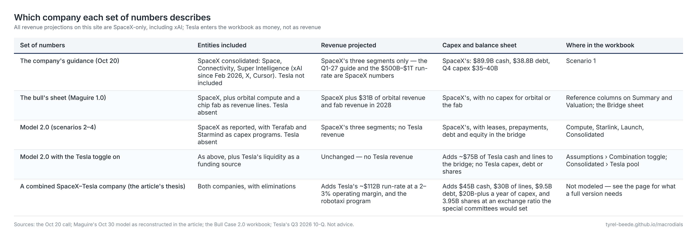
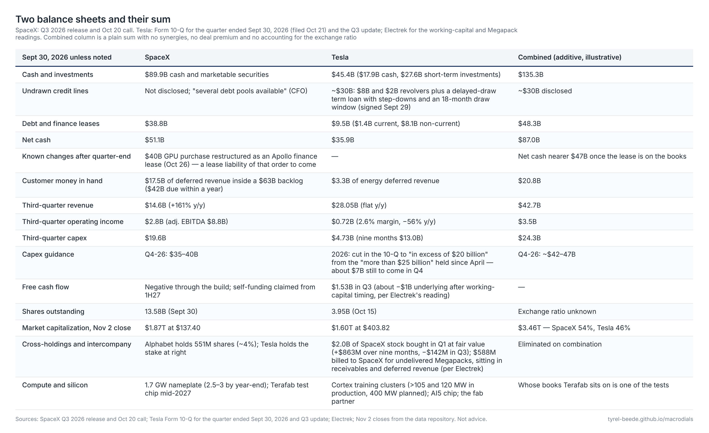

# Whose balance sheet? SpaceX, Tesla and the combination

The article's title says the two companies may need each other; the workbook projects one of them. That gap is deliberate, but it leaves a fair question for anyone using the numbers: which version of the company is being projected — SpaceX as it reports, SpaceX with the programs the bull's sheet gives it, or the combined SpaceX–Tesla machine the thesis describes? This page answers that directly, then lays the two balance sheets side by side as they stood at Sept 30, 2026, adds them up, and says what a full combined model would need that the workbook does not have.

## Which company the numbers describe

Every revenue projection on this site is SpaceX-only, and "SpaceX" already means more than rockets. Since xAI became its subsidiary in February 2026 the company reports three segments — Space (launch), Connectivity (Starlink) and Super Intelligence, which holds the compute fleet, Grok, X and Cursor — and it is that consolidated company whose third quarter was $14.6 billion of revenue and whose management guided $33–37 billion for the first quarter of 2027 and "$500 billion to $1 trillion" of run-rate by the end of it. Those are not combined-company numbers; Tesla is not in them.

The bull's sheet is SpaceX too, with two additions the company has announced but not yet booked: orbital compute as a revenue line in 2028 and a chip fab the same year, both without capex. The workbook keeps SpaceX as reported and carries Terafab and Starmind as capex programs instead, with no revenue inside the horizon.

Tesla enters the workbook in one place only: a toggle on the Assumptions sheet that lets about $75 billion of Tesla's liquidity — cash and investments plus the credit lines it signed in late September — fund SpaceX's bridge before any outside money is raised. It adds no Tesla revenue, capex, debt or shares. That is the "better together" case in its narrowest form, the balance-sheet form, which is the form the article argues is what Tesla brings.

[{ .tbl }](images/versions.png)

??? note "Text version (selectable)"
    --8<-- "model/tables/versions.md"

## SpaceX at Sept 30

SpaceX ended the third quarter with $89.9 billion of cash and marketable securities against $38.8 billion of debt and finance-lease obligations, per its earnings release — net cash of about $51 billion, after a June IPO whose proceeds have been reported at $75–86 billion and a $25 billion bond. Customers had paid $17.5 billion in advance, inside a $63 billion backlog of which $42 billion is expected within a year. The quarter's capex was $19.6 billion; the fourth quarter is guided to $35–40 billion.

Two things happened after the quarter closed that belong on the sheet. On Oct 26 a $40 billion GPU purchase was restructured as a finance lease with Apollo — vendor financing rather than cash raised, which keeps the cash balance but adds a lease liability of that order. And the lock-up calendar continued: the final 17% of the pre-IPO pool, about 798 million shares, unlocks on Dec 8, with the Musk group's 7.8 billion shares beginning to release after the fourth-quarter report. Neither changes the balance sheet; both change who can sell against it.

At the Nov 2 close of $137.40 the company's 13.58 billion shares were worth about $1.87 trillion. Alphabet, the largest institutional holder, owns 551 million of them — about 4%, roughly $76 billion — and its own free cash flow turned negative in the third quarter.

## Tesla at Sept 30

Tesla's quarter, reported Oct 21, was a flat one at the top — $28.05 billion of revenue, unchanged from a year earlier — and a thin one underneath: $718 million of operating income, a 2.6% margin, down 56%. Cash and short-term investments stood at $45.4 billion ($17.9 billion of cash, $27.6 billion of investments) against $9.5 billion of debt and finance leases, for net cash of about $36 billion. On Sept 29 the company added roughly $30 billion of undrawn capacity: $8 billion and $2 billion revolving facilities and a delayed-draw term loan with step-downs and an eighteen-month draw window, which is the kind of facility a company signs when it expects to need money on a schedule.

Capex was $4.73 billion in the quarter and $13.0 billion over nine months, against full-year guidance the 10-Q cut to "in excess of $20 billion" from the "more than $25 billion" it had held since April — which leaves about $7 billion for the fourth quarter, and makes Tesla a company trimming its build while its would-be partner guides $35–40 billion for the same quarter. Free cash flow was $1.53 billion, but about $2.6 billion of the quarter's operating cash flow was working-capital timing by Electrek's reading of the 10-Q, which would put the underlying figure roughly a billion dollars negative. The operating-expense line the update blames is "SI and other R&D projects" — SI being Tesla's own name for its AI programs too.

Two lines tie the two balance sheets together already. Tesla bought $2.0 billion of SpaceX stock in the first quarter, before the IPO, and carries it at fair value through earnings: an $863 million unrealized gain over nine months, including a $142 million loss in the third quarter. And Tesla billed SpaceX $588 million in the quarter for Megapack batteries "that have not been delivered," an amount that sat at quarter-end in both accounts receivable and deferred revenue — a bill for product not yet shipped, unpaid, disclosed the day after SpaceX guided fourth-quarter capex to $35–40 billion. Beyond the cash, Tesla brings the pieces of the stack SpaceX lacks: the AI5 chip and its fab partner, the Cortex training clusters (more than 105 and 120 megawatts in production, 400 planned by year-end, against SpaceX's roughly 2,000), Megapack batteries for the data centers, and 3.95 billion shares at $403.82 — a currency worth about $1.6 trillion, held by a large retail and index base that could fund a compute build in paper rather than cash.

## The two together

Added without adjustment, the combination at Sept 30 holds $135 billion of cash and investments and $30 billion of disclosed undrawn lines against $48 billion of debt and leases — net cash of $87 billion, nearer $47 billion once the Apollo lease is on the books — and earns $42.7 billion of quarterly revenue at $3.5 billion of operating income, while spending $24 billion a quarter on capex with $42–47 billion guided for the fourth. At Nov 2 prices the combined market value is about $3.46 trillion, 54% of it SpaceX and 46% Tesla.

[{ .tbl }](images/balance-sheets.png)

??? note "Text version (selectable)"
    --8<-- "model/tables/balance-sheets.md"

The sum is illustrative, and the illustration has three honest limits. The first is that a combination is a transaction, not an addition: the cross-holdings and the Megapack bill are eliminated, and the share count depends on an exchange ratio that the special committees the article mentions would set. At current prices a SpaceX holder owns 54% of the combined value and a Tesla holder 46%; any premium paid to either side moves that line, and the per-share value of the combined company to a SpaceX holder is the combined equity value times SpaceX's share of it, divided by SpaceX's 13.58 billion shares — which is the same $137.40 unless the deal changes what the market believes about the whole. The second is that Tesla's cash is not free: it funds a company spending $25 billion a year that generates about nothing underneath, and the robotaxi program the article treats as the second engine is a cost before it is a cash flow. The third is that the combination would not change the compute economics at all — the fleet still has to be priced at market and depreciated honestly — it would change who carries the bridge and in what currency.

## What the combination changes in the model, and what a full version would need

In the workbook as it stands, switching the Tesla toggle on does one thing: it lets the bridge draw on $75 billion before raising outside money. In the Bull 2.0 base case that covers the entire $31 billion of external funding and leaves the leases and prepayments as they are; in Branch B it covers most of the $85 billion the bridge needs and converts a shareholder's dilution into a combined company's cash. That is the narrow claim of the thesis made countable: the equity raise that a strained window would force on a standalone SpaceX becomes a transfer inside a combined balance sheet.

A full combined model would need five things the workbook does not have, and they are listed here so that anyone building it starts from the right questions:

1. **A Tesla segment** — automotive and energy revenue (about $112 billion of run-rate at a 2–3% operating margin today), its own capex (in excess of $20 billion this year, after the cut) and its own depreciation, with the robotaxi business modeled as a cost before a revenue.
2. **Eliminations** — the SpaceX stake and its mark-to-market, the Megapack receivable and deferred revenue, and any compute Tesla's Cortex sells or rents to the combined fleet.
3. **The silicon on one set of books** — Terafab's capex and, later, its cost advantage sit today in SpaceX's plan; whose books carry them is one of the dated tests, and in a combined company it stops mattering.
4. **An exchange ratio** — without it there is no per-share number for either holder; with it, the Valuation sheet's two methods apply to the combined entity unchanged.
5. **The debt capacity of the whole** — a combined company with $87 billion of net cash, Starlink's cash flow and Tesla's currency borrows on different terms than a standalone SpaceX leasing GPUs from Apollo; the debt rate and debt share on the Assumptions sheet are the cells that would move.

Until those exist, the right reading of every number on this site is: SpaceX as it reports, including xAI, with Tesla's balance sheet available as money and nothing else.

!!! note "Sources and caveats"
    SpaceX figures from the Q3 2026 earnings release and the Oct 20 call. Tesla figures from its Form 10-Q for the quarter ended Sept 30, 2026 (filed Oct 21) and the Q3 shareholder update; the working-capital and Megapack readings are Electrek's. Prices are the Nov 2 close from the data repository. The combined column is an addition with no synergies, no premium and no exchange ratio, and nothing here is advice.
