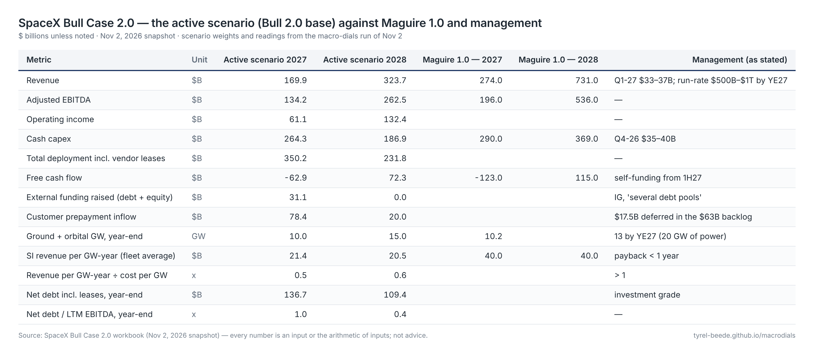
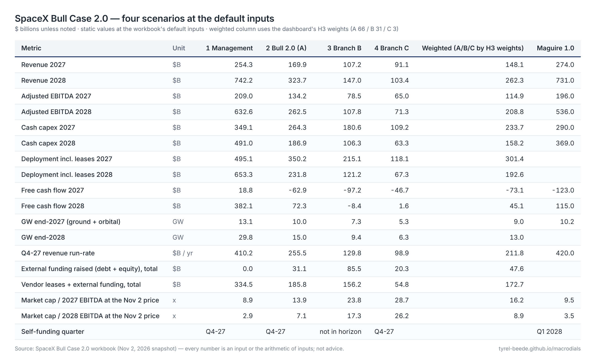
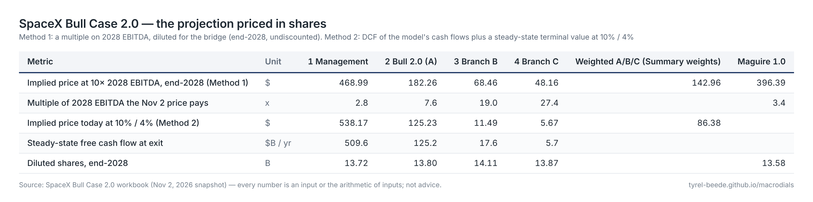

# Models

## SpaceX Bull Case 2.0

A bottoms-up quarterly model of SpaceX from Q3-26 (actual) through Q4-28, rebuilt after *Better Together Than Alone* with the corrections the article identified: the internal half of the fleet earns Grok's product revenue rather than a per-watt price; external revenue is price per GPU-hour × hours × utilization; cost per gigawatt sits on the CFO's "$30–50 per watt"; GPUs depreciate over four years; orbital compute and the fab carry capex; Starlink and launch are real segments; and a funding bridge of prepayments, vendor leases, debt and equity computes the self-funding quarter instead of assuming it.

[Download the workbook (.xlsx)](../files/SpaceX_Bull_Case_2.0.xlsx){ .md-button .md-button--primary }

[Three sets of numbers: how to read it](three-numbers.md){ .md-button }

[Whose balance sheet: SpaceX, Tesla and the combination](balance-sheets.md){ .md-button }

Every number in the workbook is an input (blue) or the arithmetic of inputs. The scenario selector on the Assumptions sheet switches the whole model between **1 Management as stated**, **2 Bull 2.0 base (Branch A)**, **3 Branch B** (capex bust) and **4 Branch C** (credit crunch) — the dashboard's branches. The tables below are exported from the saved workbook each time the site builds, so they show the workbook's active scenario (Bull 2.0 base) and its static four-scenario snapshot. Each is an image — click it for the full-size PNG, which can be saved, copied or linked directly — with a selectable text version underneath.

### The active scenario against the 1.0 sheet and management's words

[{ .tbl }](images/summary.png)

??? note "Text version (selectable)"
    --8<-- "model/tables/summary.md"

### Four scenarios at the default inputs

[{ .tbl }](images/snapshot.png)

??? note "Text version (selectable)"
    --8<-- "model/tables/snapshot.md"

### Priced in shares

Two methods: a multiple on 2028 EBITDA with dilution from the bridge (an end-2028 target, undiscounted), and a discounted cash flow of the model's own flows plus a steady-state terminal value (a present value). The "multiple the Nov 2 price pays" row is the same share price read against each projection.

[{ .tbl }](images/valuation.png)

??? note "Text version (selectable)"
    --8<-- "model/tables/valuation.md"

!!! note "What this is and is not"
    A sketch for debate, not a forecast, and not advice. The 1.0 figures are the article's reconstruction of a posted spreadsheet, quoted with its author's own caveats (wide error bars; Sequoia is a major SpaceX shareholder). Sources for every input are in the workbook's notes column.
