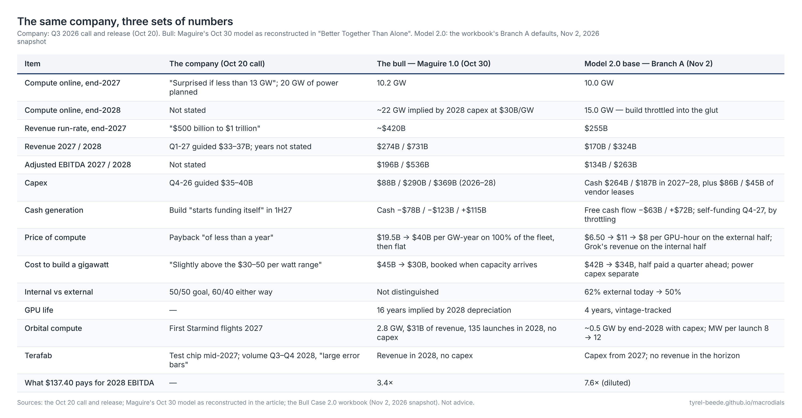
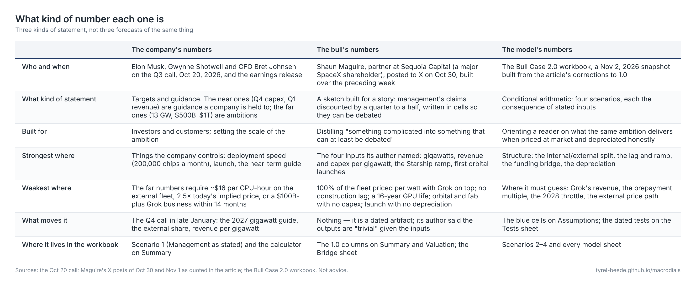
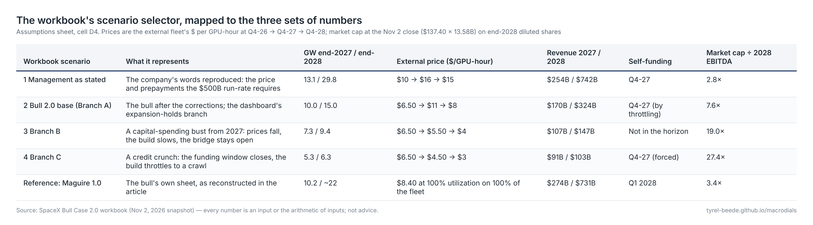

# Three sets of numbers: the company's, the bull's, and the model's

Anyone who opens the Bull Case 2.0 workbook meets three different versions of SpaceX: the one management describes, the one the bull's spreadsheet models, and the one the workbook computes. They are not three forecasts of the same quantity. They are three kinds of statement, made by different people for different purposes, and a reader who treats them as interchangeable will be surprised in both directions — the company's numbers will look like the model has been built by a bear, and the model's numbers will look like the company is being dismissed. Neither is the case. This page sets out what each set is, where it comes from, what it is good for, and what to expect from it, so that the scenario selector on the Assumptions sheet makes sense before the first cell is changed.

??? note "Text version (selectable)"
    --8<-- "model/tables/three-numbers.md"

## The company's numbers

The company's numbers are the ones said on the third-quarter call of Oct 20, 2026 and in the earnings release: 1.7 gigawatts of nameplate compute at the end of September, about two in October, 2.5 to 3 by year-end; "I would be surprised if we brought on less than 13 GW of compute by the end of next year," with 20 gigawatts of power, cooling and infrastructure planned so that power is not the constraint; $100 billion of annualized revenue by December 2026 and "somewhere between $500 billion and $1 trillion" of run-rate by the end of 2027; fourth-quarter capex of $35–40 billion; first-quarter 2027 revenue of $33–37 billion; new deployments costing "slightly above the $30–50 per watt range" with payback "of less than a year"; a rough 50/50 split of the fleet between outside customers and the company's own products; and a build that "starts funding itself, beginning in the first half of 2027" while the company keeps its investment-grade rating.

Two things about these numbers matter more than their size. The first is that they are not all the same kind of claim. The near ones — the capex guide for the current quarter, the revenue guide for the next — are guidance in the ordinary sense: a public company is held to them, and a miss is an event. The far ones — 13 gigawatts, $500 billion to $1 trillion — are ambitions, said by a founder with a long record of reaching impossible targets late. They set the scale of the bet; they are not something the company has promised to deliver on a date.

The second is that the far numbers carry an implicit claim about price, not just volume. The workbook's calculator on the Summary sheet makes it explicit: a $500 billion run-rate at the end of 2027 on 13 gigawatts, with half the fleet sold outside at 85% utilization, requires about $16 per GPU-hour on the external fleet, against roughly $6 implied by the third quarter's cloud revenue and $4 to $6.70 on the published price cards for the current generation. Either the price of compute rises two and a half times in fourteen months, or Grok becomes a business earning more than $100 billion a year on the internal half, or the number is not reached. That is what "surprised if less than 13" and "$500 billion to $1 trillion" mean when written in cells together.

The workbook keeps the company's numbers as scenario 1, *Management as stated*. It is there to show what the words require — the price path, the prepayments, the vendor leases — not as a forecast. Run that way, it produces $254 billion of revenue in 2027 and $742 billion in 2028 and funds itself from the fourth quarter of 2027. Those outputs are only as real as the $16 price.

## The bull's numbers

The bull's numbers are Shaun Maguire's. A partner at Sequoia Capital — a major SpaceX shareholder, which he disclosed — he posted a "bottoms up" financial model of the company through the end of 2028 to X on Oct 30, built over the preceding week. He called the numbers "insane," flagged "wide error bars given how quickly things are changing," and said the point was "to distill something complicated into something that can at least be debated." Two days later he added that the model estimates four inputs — how many gigawatts are online in 2027 and 2028, how revenue and capex per gigawatt change over time, how Starship launches ramp, and when the first orbital compute satellites fly — with everything else "trivial outputs" of those choices.

The sheet puts revenue at $51 billion in 2026, $274 billion in 2027 and $731 billion in 2028; EBITDA at $28, $196 and $536 billion; capex at $88, $290 and $369 billion; cash falling by $78 billion and $123 billion before rising $115 billion in 2028. It has 10.2 gigawatts online at the end of 2027 and a run-rate of about $420 billion at that point, and it self-funds in 2028. Read against the company's words, it is management discounted by a quarter to a half — fewer gigawatts, less revenue, self-funding a year later — and the founder replied to it in six words: "I think we can do better."

Read against its own cells, it is more generous than management in ways that do not show up in the headline figures, and these are the reasons the 2.0 model exists. It prices 100% of the fleet at $40 billion per gigawatt-year and adds Grok's revenue on top, when management says half the fleet is internal and an internal customer earns what its own customers pay. It books capex in the quarter capacity arrives, with no construction lag and no ramp. Its 2028 depreciation implies a sixteen-year life for GPUs. Its orbital line carries 2.8 gigawatts, $31 billion of revenue and 135 launches with no capex anywhere; its chip fab books revenue in 2028 with no capex either; and its launch segment stops depreciating from mid-2027. None of that makes the narrative wrong. It makes the sheet what its author said it was: a sketch built for a story, and the best public articulation of the bull case precisely because it can be checked.

The workbook does not run the bull's sheet as a scenario. It keeps it as a reference — the 1.0 columns on the Summary and Valuation sheets and the Bridge sheet, which walks through what changed on each of the four inputs.

## The model's numbers

The model's numbers are the workbook's own: the bull's structure with the article's corrections applied, computed quarter by quarter from the third quarter of 2026 through the end of 2028, under four scenarios wired to the macro dashboard's branches. Every number is an input or the arithmetic of inputs, and every input carries a note saying where it came from.

The base case, scenario 2, is the bull after the corrections. The fleet reaches 10 gigawatts at the end of 2027 — the bull's own figure — and then the build is throttled to about a gigawatt a quarter as prices soften, so it ends 2028 at 15 rather than the twenty-odd the bull's capex implies. The external share of the fleet runs from 62% today toward management's 50%, and only that share earns a price: $6.50 per GPU-hour today, rising to $11 at the top of the scarcity window at the end of 2027, easing to $8 through the 2028 glut. The internal half earns what Grok, X and Cursor's customers pay, growing fast from a small base. Deployments cost $42 billion a gigawatt falling to $34 billion, half of it paid a quarter before the capacity is energized, with power and cooling on top; GPUs depreciate over four years; orbital compute and the fab pay for themselves on the way in.

On those inputs the company earns $170 billion of revenue in 2027 and $324 billion in 2028, with EBITDA of $134 billion and $263 billion; it spends $264 billion and $187 billion of cash on capex, with a further $86 billion and $45 billion financed by vendor leases; free cash flow is −$63 billion in 2027 and +$72 billion in 2028; and it funds itself from the fourth quarter of 2027. The self-funding date lands close to management's claim, but for the opposite reason: not because the fleet pays for itself inside a year — revenue per gigawatt-year runs $17 to $24 billion against $34 to $42 billion to build one, a ratio of 0.5 to 0.6 that never reaches one — but because the build is cut as the glut arrives. The outside money that bridges 2027 is mostly customer prepayments ($97 billion over the horizon) and vendor leases ($155 billion), with only $31 billion of new debt and equity. That is the cycle-rider's play described in the article, written in cells.

Scenarios 3 and 4 are not pessimistic flourishes; they are the dashboard's other branches. In a capital-spending bust (B) prices fall to $4, the build slows, revenue is $107 billion and $147 billion, and the bridge never closes. In a credit crunch (C) the funding window shuts and the build throttles to a crawl; revenue is $91 billion and $103 billion, and the company "self-funds" only because it has stopped building.

??? note "Text version (selectable)"
    --8<-- "model/tables/provenance.md"

## The same share price, read three ways

The three sets of numbers meet the market at one price. At the Nov 2 close of $137.40, SpaceX's market capitalization of about $1.87 trillion is 3.4 times the bull's 2028 EBITDA, 7.6 times the 2.0 base case's on diluted shares, and 2.8 times the company's own numbers run through the workbook. The same price, in other words, is either a market that does not believe the bull's number or one that believes the model's and wants a return on it. Run the other way, at a mature compounder's ten times 2028 EBITDA, the bull's sheet implies about $396 a share at the end of 2028 and the base case about $182; discounting the base case's own cash flows plus a steady-state terminal value at 10% and 4% growth gives about $125 today. The Valuation sheet carries the arithmetic, the dilution from the bridge, and the sensitivities to the multiple and the discount rate — which are large, and which are the honest statement of how much of any of this is yardstick rather than model.

## Using the three together

The expectation to carry into the spreadsheet is a spread, not a point. The company's numbers are the ceiling and contain an unstated price. The bull's sheet is a story-shaped version of the ceiling, more generous than it looks. The base case is what the same ambition delivers when the fleet is priced at market and depreciated honestly, and it still comes out as a large, fast-growing, self-funding company — just not the one in the headline figures. The gap between the top and the bottom is the size of the bet, and the article's phrase for it applies: it is the market's probability that the funding and pricing assumptions hold.

??? note "Text version (selectable)"
    --8<-- "model/tables/scenarios.md"

Three running numbers tell you which set of numbers the world is moving toward, and the workbook shows each: gigawatts energized (the Compute sheet, against the 13 the founder has promised), revenue per gigawatt-year against the cost per gigawatt (the bottom of the Compute sheet; payback under a year needs it above one), and the funding mix (the bottom of the Consolidated sheet; a shift from cash flow and vendors toward new equity and long-term contracts is the bridge under strain). The first reported figures that all three sets of numbers will meet arrive with the fourth-quarter call in late January: the 2027 gigawatt guide, the external share of the fleet, and revenue per gigawatt. The Tests sheet lists the rest, with dates, and the input in the workbook that each one moves. One more orientation question — which company these numbers describe, and what Tesla's balance sheet adds — has its own page: [Whose balance sheet?](balance-sheets.md)

!!! note "What this is and is not"
    An orientation to a sketch, not a forecast and not advice. The company's figures are quoted from the Oct 20 call and release; the bull's from Maguire's posted spreadsheet as reconstructed in *Better Together Than Alone*, with his own caveats; the model's from the workbook's defaults as of the Nov 2, 2026 snapshot. Change the blue cells and the model's numbers change with them.
